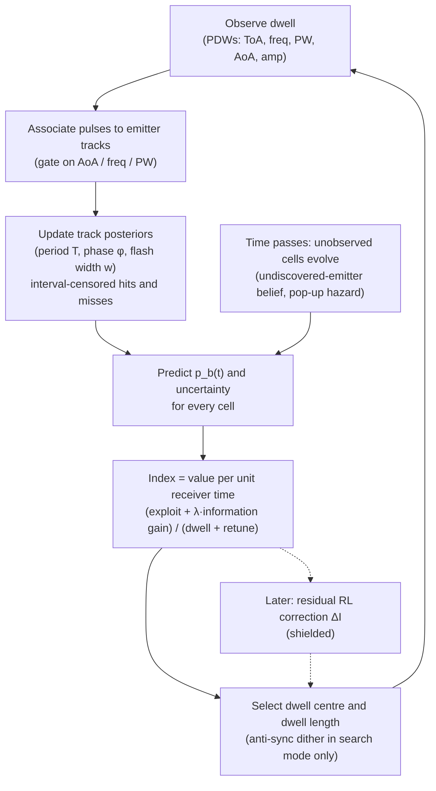

# Eklavya Strategy for Electronic Warfare

## Context

An Electronic Support (ES) receiver must maintain surveillance over 0.5–18 GHz with an instantaneous bandwidth far narrower than the band it covers, so it has to sweep. Classical practice is **open-loop**: a periodic sweep driven by pre-mission intelligence and tuned for raw speed. It fails in two ways:

1. It spends equal time on silent or benign bands as on new or threatening ones.
2. A periodic sweep against a periodic emitter can **synchronise**. When sweep and scan periods are commensurate the emitter is never intercepted. When they are near-commensurate it is intercepted only on a very slow beat (Clarkson's lock-out result). Sweeping faster does not fix this and can cause it.

The problem statement removes the crutch: **no prior reliable intelligence** on emitters. The scheduler must discover each emitter's temporal behaviour from its own hits and misses and exploit it to minimise intercept time and maximise interception ratio.

**Intended outcome:** a machine-learning ES scheduler that beats open-loop, greedy and DQN baselines on time-to-first-intercept and interception ratio. It comes with a reproducible harness reporting every figure of merit the problem statement names, is validated against the Turing Synthetic Radar Dataset, and uses ablations to show which component produces the gain.

---

## Design principle

> **Do not use machine learning to rediscover everything from scratch when part of the problem can be modelled explicitly.**

Our dataset analysis ([`docs/DATASET_NOTES.md`](docs/DATASET_NOTES.md)) makes this concrete. The median emitter is a **~14 ms main-beam flash every ~4 s**, so a 30 s engagement yields about 7 flashes, and the scheduler must learn from the first 2–3. Model-free deep RL cannot do that. An explicit, Bayesian model of flash timing can. RL is therefore the **residual optimisation layer**, not the foundation.

### Why this approach (research verdict)

| Family | Role in Eklavya |
|---|---|
| Open-loop periodic sweep; Farey/Diophantine-optimised sweep (Clarkson 2011) | Baselines, plus the analytic treatment of optimal periodic interception in the report |
| Myopic / greedy on a belief state | Baseline. Cannot represent the phase of a periodic scanner. |
| Restless multi-armed bandit, Whittle / marginal-productivity index (Liu & Zhao; PCL for imperfect binary feedback) | Theoretical backbone of the Index layer. The MVP uses a simpler rate index. |
| Double-DQN scheduler (current published ML approach) | **ML comparator.** It is what Eklavya must beat. |
| Residual deep RL (NeurWIN-style learned index correction) | Extension layer (Phase 6), bounded by a shield |
| Full POMDP solvers | Intractable at 36 centres × many emitters. Not used. |

---

## Architecture



### Observe & associate

A dwell returns pulse descriptor words, not a bit. Pulses are associated to **emitter tracks** by gating on angle of arrival, frequency and pulse width. Unassociated singletons go to a clutter / false-alarm track.

This matters because bands are shared: validation scenarios average **51 emitters over 36 dwell centres**. A single periodic hypothesis per band breaks as soon as two periodic emitters share it. Each track gets its own temporal model, and cell-level prediction combines them.

- **MVP:** gating plus DBSCAN on (AoA, freq, PW).
- **Extension:** a learned embedding such as the transformer metric-learning deinterleavers trained on the Turing dataset.

### Predict

**Hypothesis bank per track:**
- periodic flash (circular scan)
- continuous (omni)
- Gilbert–Elliott Markov
- frequency-agile (hop set spanning cells)
- aperiodic / Poisson

**Per cell:** an **undiscovered-emitter** belief.

The MVP implements periodic plus undiscovered first, because that directly addresses the lock-out failure mode.

**Periodic flash model.** Emitter `e` is illuminating us at time `t` iff `(t − φ) mod T < w`.

**Interval-censored evidence** is used instead of per-slot hit/miss:
- **A hit** gives flash-edge arrival times to sub-millisecond accuracy. Edges clipped by the dwell boundary are treated as censored.
- **Two hits** at `t₁ < t₂` restrict the period to `T ∈ {(t₂ − t₁)/k : k = 1…K}` within the prior support. This generates the candidate `(T, φ)` set.
- **A miss** of length `d` rules out, for every candidate, the phase interval of length `d + w`. Likelihood: `1 − P_d · 1[overlap]`.
- **The posterior** is a weighted candidate set, pruned by weight. The research version refines `T` with Clarkson–McKilliam lattice ML period estimation over the associated hit times.
- **Before the second hit,** the track is a mixture over the learned prior on `T`, so predictions are smooth rather than empty.

**Undiscovered-emitter belief** `q_k` per 250 MHz cell:
- It decreases after a miss, by the average detection chance under the prior over `(T, w)`.
- It grows between looks with a pop-up hazard `ρ`: `q ← 1 − (1 − q)·e^{−ρΔt}`.
- **Unobserved cells are therefore never frozen.** Starving a "silent" band makes it steadily more valuable to look at. This restless behaviour is what finds new emitters.

**Cell prediction:**

$$
p_k(t) = 1 - (1 - q_k\,\bar p_{\text{new}}) \prod_{e \in \text{tracks}(k)} \big(1 - p_e(t)\big), \qquad p_e(t)=\sum_h w_h\, p_{e,h}(t)
$$

Uncertainty is carried by the hypothesis weights `w_h`, which tells Eklavya which cells are worth observing to learn, not only which are likely to transmit.

**Learned priors (the MVP's trained component).** Priors over period, flash width, agility mode and emitter density are **fitted from the 2,500 `train_scan` scenarios** (metadata streamed via the HF API; see Environment & data). This is trained on data, speeds up learning from the first flashes, and is ablated (learned prior vs. flat prior). At run time the scheduler never sees scenario metadata, so it still starts with no intelligence about the emitters in front of it.

### Index

An action is `(dwell centre c, dwell length d)`, with `c` one of 36 centres at 500 MHz spacing covering ±500 MHz (so adjacent centres overlap by 50 %) and `d ∈ {10, 25, 50, 100} ms`. The receiver shares its time across bands, so the index is **value per unit of receiver time**:

$$
I(c,d) = \frac{\displaystyle\sum_{e \in \mathcal{E}(c)} W_e(t)\, P_e\big(\text{intercept in }[t, t+d]\big) \;+\; \sum_{k \in \mathcal{K}(c)} W_{\text{new}}\, q_k\, \bar P_{\text{det}}(d) \;+\; \lambda\, IG(c,d)}{d + \tau\,\mathbb{1}[c \neq c_{\text{prev}}]}
$$

- **Intercept probability** for a periodic hypothesis, with `u = (t − φ) mod T`: `P = P_d · 1[u < w_eff ∨ u > T − d_eff]`. Widths are shortened by the minimum pulse count needed for a detection. Averaged over the posterior.
- **Overlap handling:** sums run over the **unique** tracks `𝓔(c)` and cells `𝓚(c)` a centre covers, so an emitter in an overlap region is never double-counted. With `K > 1` simultaneous receivers, centres are chosen greedily by marginal coverage gain (submodular, `1 − 1/e` guarantee).
- **Staleness weight:** `W_e(t) = W_threat,e · g(time since last intercept of e)`, with `g` increasing. It rewards re-intercepting tracks that are going stale, and stops the scheduler farming one loud emitter.
- **Information gain,** closed form for a binary intercept outcome `y`:

$$
IG = H\Big(\sum_h w_h\, p_h\Big) - \sum_h w_h\, H(p_h)
$$

 where `H` is binary entropy and `p_h = P(y = 1 | h)`. It peaks where hypotheses disagree. A hit carries timing information beyond a bit, so this is a conservative lower bound.
- **Tuning:** `λ`, `ρ`, `τ` and the dwell set are tuned by Bayesian optimisation on training scenarios, never on validation or test.
- **Explanation:** every decision is logged with its terms. For example: *"centre 3250 MHz, 25 ms: track 7 predicted flash in 12 ms (P = 0.81), staleness 3.2 s, IG 0.4 bits."*
- **Research version:** replace the rate index with a Whittle / marginal-productivity index over the predictive process, check indexability numerically, and fall back to the PCL formulation for imperfect binary feedback.

### Anti-synchronisation

Once Eklavya tracks emitters, its look times are driven by predictions and it breaks synchronisation by itself. Lock-out risk returns in **search mode**: when beliefs are flat, the index ordering degenerates into a deterministic sweep. There, and only there, Eklavya dithers:
- Choose among ε-near-tied actions using a golden-ratio low-discrepancy sequence.
- Randomise the dwell start offset.
- Assert that the realised search revisit interval is not near-commensurate with the period prior's support.

### Learn (Phase 6, extension)

$$
I^{\text{final}}(c,d) = I^{\text{analytic}}(c,d) + \Delta I^{\text{RL}}(c,d)
$$

- **Residual policy:** a small GRU policy trained with PPO on randomised scenarios learns `ΔI`, only the part the explicit model misses.
- **Shield:** clamps the combined policy so its value on the analytic objective never falls more than a set margin below the analytic choice.
- **Evaluation:** on held-out scenario families.
- **Benefits:** a working intelligent scheduler exists before any RL training; decisions stay explainable; and RL is judged against analytic Eklavya, not merely against open-loop sweeping.

---

## Environment & data

**Simulator-first.** The simulator (`primes/env/`) is the primary development environment. Its receiver defaults replicate the Turing Scan-Mode receiver, verified on all 250 `val_scan` files:
- 36 dwell centres, 250–17750 MHz
- acceptance `|f − centre| ≤ 500 MHz`
- open-loop schedule: a 2.15 s cycle of 50 / 100 ms dwells repeating from t = 0
- this model explains **99.987 %** of 22.7 M scan pulses

**Emitters:**
- **Scan:** circular (period `T = 60/rpm`, flash width `w = T·beamwidth/360`) or omni.
- **PRI:** fixed, staggered, jittered, sliding, switch-dwell.
- **Frequency:** fixed, multi-simultaneous, hopping linear / sawtooth, random. Hopping emitters span 1–3 sub-bands.
- **Stochastic:** Markov emitters and pop-up emitters appearing mid-engagement.
- **Pulses:** generated with AoA, freq, PW and amplitude plus noise, so association is realistic.

**Detection:** main-beam only, sensitivity threshold, `P_d` and `P_fa` configurable and swept.

**Truth:**
- Exact **pulse-level** truth per emitter, used for replay and scoring. Flashes can be as short as 0.33 ms, so a coarse grid would be wrong.
- A 1 ms `(cell × slot)` occupancy tensor derived from it, for learning models and plots.
- The truth is hidden from schedulers. Any policy can be replayed exactly against stored truth: **exact off-policy evaluation**, identical environments for every policy.

**Turing Synthetic Radar Dataset** (external validation):
- **Stare files** provide ground-truth pulses and labels. **Scan files** provide the published open-loop baseline over the same scenarios.
- Scan and stare files are **independent stochastic realisations**, so validation is statistical, never pulse-by-pulse.
- A few pulses have ToA > 30 s; clip to `[0, 30]` s.

**Data access:**
- **Metadata** (for priors) is **streamed** through the HF API (`HfFileSystem` + `h5py`), about 1 s per file and a few KB each, with no bulk download.
- **Pulse data** (for evaluation) is streamed **once** into a compact local cache in `data/cache/`: ToA, frequency and label per pulse, plus metadata. The cache rebuilds itself if deleted. Streaming pulses on every run would be ~20× slower than the local cache (measured) and risks rate limits.
- Splits: `val_stare` / `val_scan` for development evaluation, `test_*` for held-out final numbers. `train_stare` (49 GB) is never needed.

---

## Repository layout

```
primes/
  core/        types.py                       # TruthTensor, Look, Track, Policy / Predictor protocols
  env/         emitter.py  receiver.py  scenario.py  truth.py  gym_env.py
  track/       association.py                 # PDW → emitter tracks
  predict/     periodic.py  undiscovered.py  priors.py  hypotheses.py  calibration.py
  index/       rate_index.py  info_gain.py  coverage.py  dither.py  whittle.py
  policies/    baselines.py  oracle.py  dqn.py  primes.py  residual_rl.py
  eval/        replay.py  metrics.py  bootstrap.py  plots.py
  data/        turing_stream.py  turing_cache.py  fit_priors.py
configs/       scenario_*.yaml  policy_*.yaml  experiment_*.yaml
experiments/   run_sweep.py  ablations.py  tune_index.py
scripts/       inspect_turing_dataset.py
docs/          DATASET_NOTES.md
tests/
reports/       report.md  figures/
```

**Stack:** Python 3.12, NumPy + Numba, Gymnasium, Stable-Baselines3 (DQN, PPO), Optuna (index tuning), huggingface_hub + h5py, Hydra, pytest, matplotlib.

---

## Build phases

### Phase 1 — Environment and truth
Emitter, receiver, scenario and detection models. Pulse-level truth with the derived 1 ms tensor. Gymnasium environment with action `(centre, dwell)`. Deterministic seeding and replay.

Scenario families:
- `easy`: few fixed-frequency circular scanners
- `shared-band`: several periodic emitters per band
- `agile`
- `lockout-exact`: periods commensurate with the 2.15 s sweep
- `lockout-near`: near-commensurate, slow beat
- `popup`: emitters appear mid-run
- `dense`: Turing-matched, ~50–100 emitters

**Gate:** the simulator's raster sweep matches closed-form intercept-time results (Self 1985) for a single periodic emitter.

### Phase 2 — Baselines, metrics, replay
- **Baselines:** random, round-robin, raster (exact Turing schedule), jittered raster, myopic greedy, and a **clairvoyant oracle** that reads truth (upper bound for regret).
- **Metrics:** full metrics module (below) and bootstrap CIs over ≥ 30 seeds.

**Gate:** replay is bit-identical for identical seeds, and `lockout-exact` gives raster TTFI = ∞.

### Phase 3 — Predictive MVP
- Association (gating + DBSCAN).
- Periodic track posterior with interval-censored hits and misses, and candidate generation from hit differences.
- Undiscovered-cell belief with pop-up hazard.
- Priors fitted from `train_scan` metadata.

**Gate:**
- **Recovery:** period and phase recovered within tolerance after ≤ 3 flashes on `easy` and `shared-band`.
- **Calibration:** calibrated `p_e(t)` (reliability diagram, Brier score).
- **Priors:** the learned prior beats the flat prior on early-flash prediction error.

### Phase 4 — Smart scheduling
Rate index with information gain, overlap-aware coverage, staleness weights, dwell-length choice, and search-mode dither. `λ, ρ, τ` tuned with Optuna on training scenarios.

- **Compared against:** every Phase-2 baseline **and a Double-DQN scheduler** (SB3, same Gymnasium environment, tuned fairly).
- **Principal experiments:** `lockout-exact`, `lockout-near`, `popup`, `dense`.

**Gate:** analytic Eklavya beats greedy and DQN on TTFI (mean and p95) and interception ratio, with non-overlapping CIs, and breaks both lock-out scenarios.

### Phase 5 — Expanded predictor
- **New hypotheses:** Gilbert–Elliott Markov, frequency-agile tracks spanning cells, aperiodic / Poisson, omni.
- **Model selection:** Bayesian model selection across the hypothesis bank.
- **Degradation mode:** long-period emitters (T ≥ 15 s, ≤ 2 flashes per window) fall back to the search prior.

**Gate:** no regression on Phase-4 scenarios, and a gain on `agile` and on stochastic families.

### Phase 6 — Residual RL
GRU / PPO residual `ΔI` with shield, domain randomisation, and held-out scenario families.

Expected ordering to test:

$$
\text{Open-loop} < \text{Greedy} < \text{DQN} \le \text{Analytic Eklavya} \le \text{Eklavya + RL residual}
$$

**Gate:** shielded Eklavya+RL ≥ analytic Eklavya on every family, and any improvement holds on held-out families.

### Phase 7 — External validation, ablations, report
- **Turing validation:** stream-once cache of `val_*` / `test_*`. Replay all policies on stare truth. Statistically cross-validate the simulated open-loop sweep against Turing Scan-Mode intercept statistics.
- **Ablations:** no prediction · prediction without IG · flat vs. learned priors · no association (per-band model) · no undiscovered-cell hazard · no dither · no expanded hypothesis bank · analytic Eklavya · Eklavya + RL.
- **Report:**
 - Attribute the improvement to specific components.
 - Include the Farey/Diophantine analysis of optimal periodic interception, and whether Eklavya approaches it.
 - Map 1:1 to the problem statement's figures of merit.

---

## Figures of merit (`primes/eval/metrics.py`)

- **Detection:** probability of detection and false alarm, as functions of sensitivity and dwell (ROC).
- **Sensitivity:** swept; performance-vs-sensitivity curves.
- **Interception:** average intercept rate, and interception ratio (fraction of emitter flashes intercepted).
- **Time to first intercept** per emitter: mean, median, **p95, worst case**.
- **Reward:** average reward / cost under threat-weighted cost.
- **Prediction:** **percentage of correct predictions** (next-flash calls) and **average intercept time error** (|predicted − actual| next flash).
- **Optimality:** regret vs. clairvoyant oracle.
- **Fairness:** coverage fairness across emitters.
- **Responsiveness:** new-emitter latency (appearance → first intercept).
- **Stratification:** all of the above broken down by period relative to the 30 s window and by band occupancy, so the long-period tail cannot hide in averages.

---

## Verification

1. **Analytic cross-check:** simulated intercept-time statistics match Self (1985) and Clarkson synchronisation ratios for a single periodic emitter against a periodic sweep.
2. **Lock-out:** raster TTFI = ∞ on `lockout-exact` and slow-beat on `lockout-near`; Eklavya TTFI is finite and short on both.
3. **Receiver model:** the simulated Turing schedule reproduces the 2.15 s / ±500 MHz acceptance behaviour (already verified on the dataset at 99.987 %).
4. **Replay determinism:** same policy + truth + seed ⇒ bit-identical metrics.
5. **Predictor unit tests:**
 - candidate generation recovers the true `T` from two synthetic hits
 - misses eliminate the right phase intervals
 - the IG closed form matches Monte-Carlo mutual information
6. **Association:** purity / V-measure on simulated shared-band scenarios.
7. **Calibration:** reliability diagrams and Brier score for `p_e(t)`.
8. **Shield:** Eklavya+RL never falls below the analytic policy by more than the margin on any seed.
9. **Statistics:** headline numbers over ≥ 30 seeds with bootstrap CIs; no claims on overlapping intervals.
10. **End to end:** `python experiments/run_sweep.py --config configs/experiment_full.yaml` regenerates every figure in `reports/`.

---

## Risks

| Risk | Mitigation |
|---|---|
| Association errors merge or split emitters | Gate on AoA + freq + PW; clutter track; ablate against a truth-association oracle to bound the loss |
| Long-period emitters (≥ 15 s) give too few flashes to learn | Search-prior fallback; stratified metrics make the limitation explicit |
| "Is it ML?" before RL exists | Learned priors from 2,500 scenarios and a trained DQN comparator in Phase 4; residual RL in Phase 6 |
| Whittle indexability fails for the predictive process | The rate index is the MVP; numerical indexability check; PCL / marginal-productivity fallback |
| Residual RL overfits simulated families | Held-out families, domain randomisation, shield |
| HF streaming slow or rate-limited | Stream metadata only; stream pulses once into a local cache |
| The Turing dataset is built for deinterleaving, not scheduling | Used only for environment realism, priors and statistical validation; stated as such in the report |
