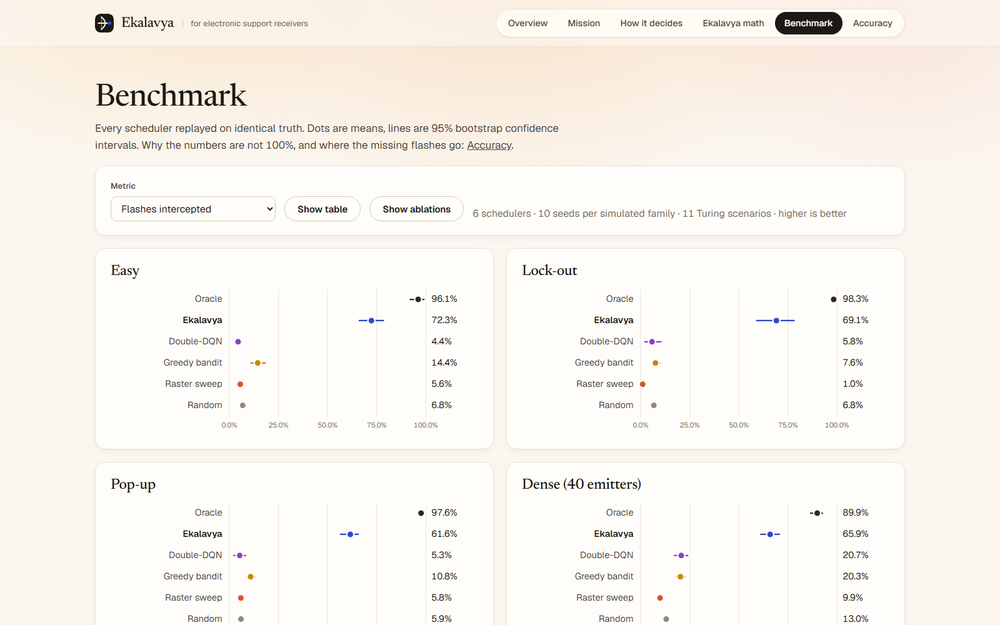
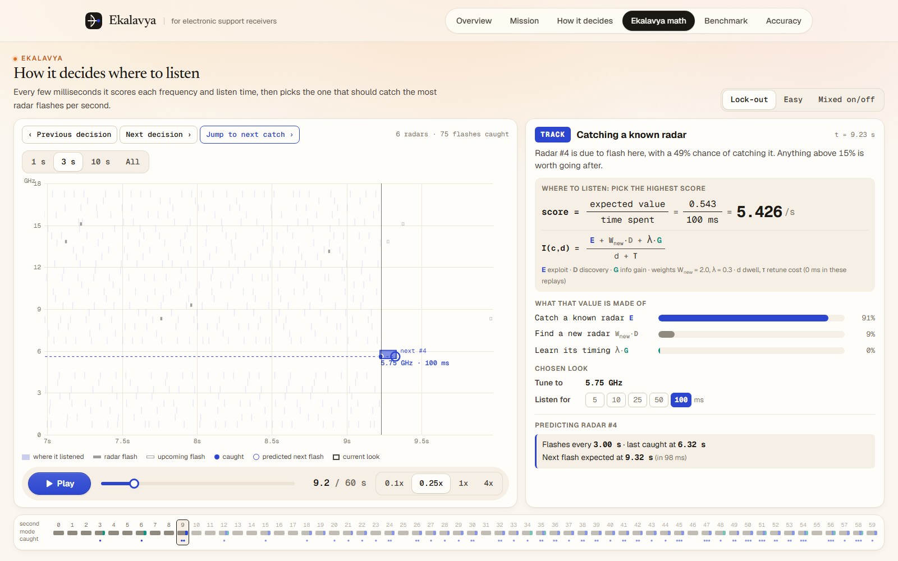
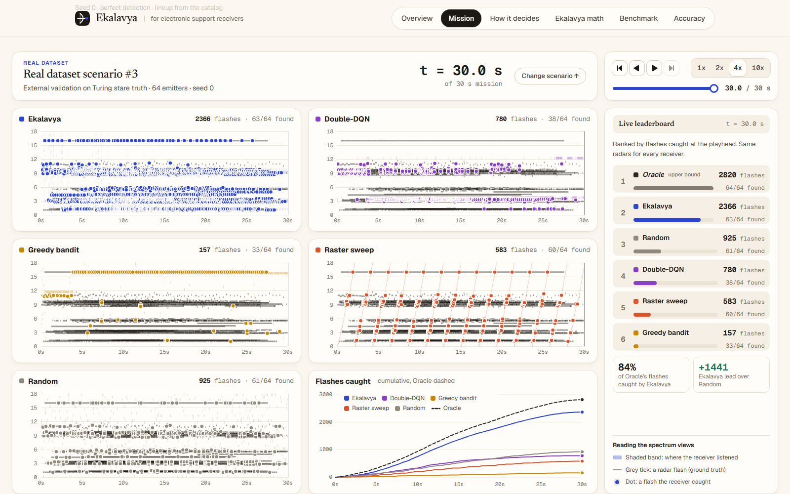
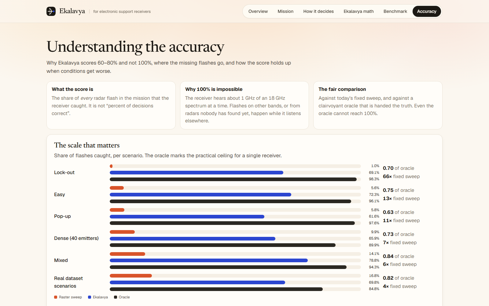

# Ekalavya Strategy for Electronic Warfare

A machine-learning Electronic Support (ES) receiver scheduler. It learns when and where to look in the spectrum without prior intelligence on the emitters it will face.

**[Live demo](https://ekalavya-arvada.pages.dev)** · **[Demo video](https://www.youtube.com/watch?v=L4syRxecqos)**


A narrowband receiver hears roughly 1 GHz of an 18 GHz spectrum at a time, and radar beams illuminate it for only milliseconds. Every dwell is therefore a bet on where the next flash will be. Ekalavya learns each emitter's rhythm from what it has already heard, predicts the next flash, and spends its listening time where the return is highest.

## Results

Interception ratio, the share of all interceptable flashes that the receiver caught. From a 610-run benchmark: 10 seeds per simulated family plus 11 scenarios from the Turing dataset, with 95 % bootstrap confidence intervals.

| Scenario | Raster sweep | **Ekalavya** | Clairvoyant oracle | Share of oracle |
|---|---|---|---|---|
| Lock-out | 1.0 % | **69.1 %** | 98.3 % | 0.70 |
| Easy | 5.6 % | **72.3 %** | 96.1 % | 0.75 |
| Pop-up | 5.8 % | **61.6 %** | 97.6 % | 0.63 |
| Dense (40 emitters) | 9.9 % | **65.9 %** | 89.9 % | 0.73 |
| Mixed | 14.1 % | **78.8 %** | 94.3 % | 0.84 |
| **Real Turing scenarios** | 16.8 % | **69.8 %** | 84.8 % | **0.82** |

The oracle is handed the truth, including the future, and still misses between 2 % and 15 % because flashes on different bands overlap in time. It is a ceiling, not a target. The meaningful comparisons are against that ceiling (0.63 to 0.84) and against the open-loop sweep in service today.



## How a decision is made

Every candidate pairing of band centre and dwell length receives a single score, which is value per second of listening:

```
I(c,d) = [ E(c,d) + W_new · D(c,d) + λ · G(c,d) ] / (d + τ)
```

`E` is the expected number of flashes caught from tracked emitters, `D` is discovery value over undiscovered ones, `G` is information gain about uncertain track phases, `d` is the dwell and `τ` is retune overhead. Dividing by time is what makes short confirmatory dwells and long search dwells directly comparable. The receiver takes the highest-scoring look, listens, and folds the outcome back into its belief, since a miss rules out phase hypotheses just as a hit confirms them.

There is no neural network in the scheduler. The learning lives in the offline priors and the online Bayesian track models, which keeps every decision inspectable: the demo shows the three score terms behind the look actually taken, at any point in a replay.



## Every receiver on one scenario

The full lineup replays identical ground truth, so any difference between them is attributable to the decision policy alone.



## Where the missing flashes go

Most of the loss happens before discovery, because nothing tells a single narrowband receiver where a radar it has never heard is. The remainder, and how the numbers hold up under missed detections and false alarms, is set out in [`docs/ACCURACY.md`](docs/ACCURACY.md).



## What is in the prototype

| Part | Where |
|---|---|
| Receiver model (Turing replica: 36 centres, ±500 MHz, 2.15 s raster), scenarios, pulse-level truth | `primes/env`, `primes/core` |
| Learned emitter priors from 2,500 Turing training scenarios (HF API) | `primes/data/fit_priors.py`, writing `primes/assets/priors.json` |
| **Ekalavya**: periodic and Gilbert–Elliott track models, undiscovered-emitter belief with learned visibility, value-per-time index with information gain | `primes/predict`, `primes/policies/primes_lite.py` |
| Baselines: raster, random, hit-rate bandit, clairvoyant oracle | `primes/policies/baselines.py` |
| **Double-DQN** comparator (Stable-Baselines3) | `primes/rl` |
| Exact replay, metrics, multi-seed benchmark with bootstrap CIs | `primes/eval`, `experiments/benchmark.py` |
| FastAPI backend | `api/main.py` |
| Next.js frontend (mission replay, decision explorer, benchmark, accuracy) | `web/` |

The scheduler is named Ekalavya in everything a reader sees. The package and policy identifiers keep the project's original name, `primes`, because they are wire values embedded in the precomputed runs and the benchmark artifacts.

## Run it

Requires Python 3.11 or later and Node 20 or later.

```bash
pip install -r requirements.txt
pytest -q                                              # 20 tests

# optional: refit priors (needs HF access; the fitted file is committed)
python -m primes.data.fit_priors --split train_scan --limit 2500

# optional: train the Double-DQN comparator (about 25 min on CPU)
python -m primes.rl.train_dqn --steps 600000

# benchmark all schedulers (writes artifacts/benchmark.json)
python -m experiments.benchmark --seeds 10 --workers 6

# backend and frontend
uvicorn api.main:app --port 8000
cd web && npm install && npm run dev                   # http://localhost:3000
```

Mission page with every receiver running at once:
`http://localhost:3000/mission?scenario=lockout`

To point the Next.js rewrite at a non-default API, set `EKLAVYA_API_URL` (default `http://127.0.0.1:8000`).

Turing scenarios (`turing:<config>`) are fetched from Hugging Face on first use and require accepted dataset access plus `huggingface-cli login`. They are stored under `data/raw/`, which is git-ignored.

## Deploy the static site

The published site carries no backend. A replay takes between 25 and 140 seconds, so nothing free will run one on demand; instead the whole API is precomputed into flat JSON and served as static files. Neither Python, nor the dataset, nor the trained model is needed to host it.

```bash
python -m scripts.export_static                        # bakes web/public/api (git-ignored)
cd web && NEXT_PUBLIC_STATIC=1 npx next build          # writes web/out
npx wrangler pages deploy out --project-name ekalavya-arvada --branch main
```

The export step is the only one that needs the Turing dataset and `artifacts/models/dqn.zip` present locally, which is why the baked output includes the real scenarios and the reinforcement-learning comparator even though the deployment has neither.

## Documentation

| Document | Contents |
|---|---|
| [`docs/EKLAVYA_FULL_ARCHITECTURE.md`](docs/EKLAVYA_FULL_ARCHITECTURE.md) | Full design, roadmap and risk register |
| [`docs/EKLAVYA_PROTOTYPE.md`](docs/EKLAVYA_PROTOTYPE.md) | Prototype scope |
| [`docs/ACCURACY.md`](docs/ACCURACY.md) | Why the numbers are what they are, and what would raise them |
| [`docs/DATASET_NOTES.md`](docs/DATASET_NOTES.md) | Findings from the Turing dataset |
| [`PLAN.md`](PLAN.md) | Original plan |

## Branching

Every feature is developed on its own branch and merged into `main` by pull request.
