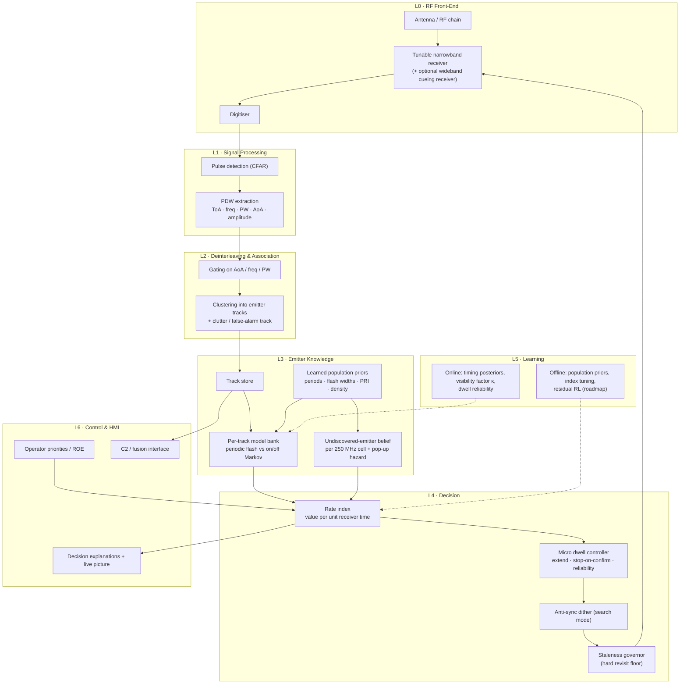
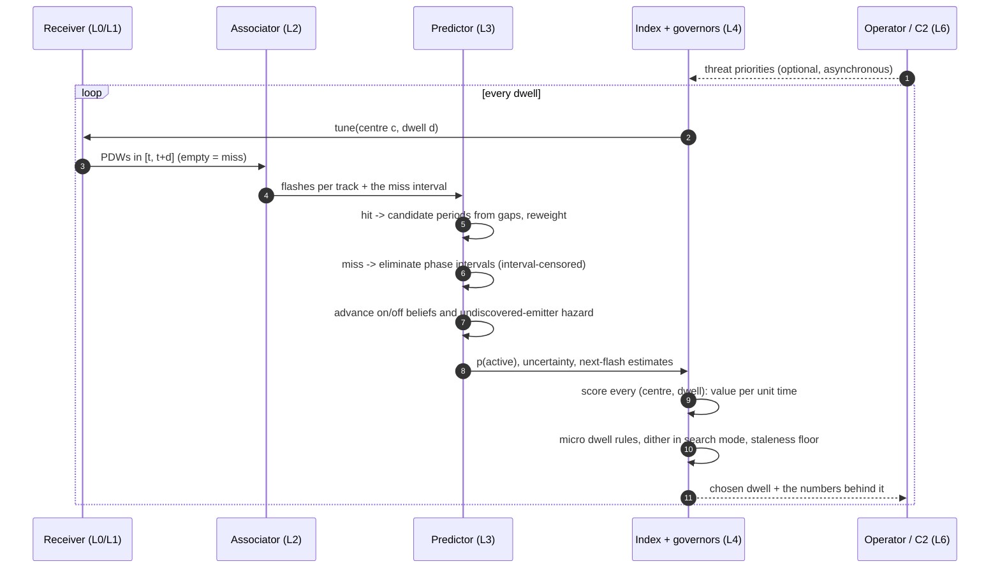
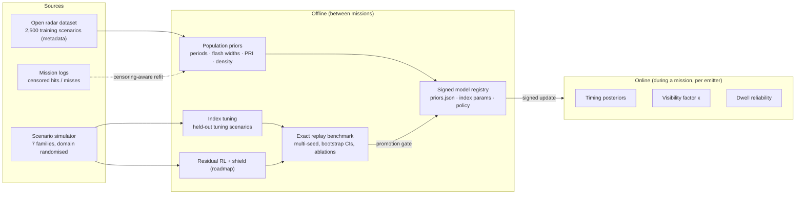
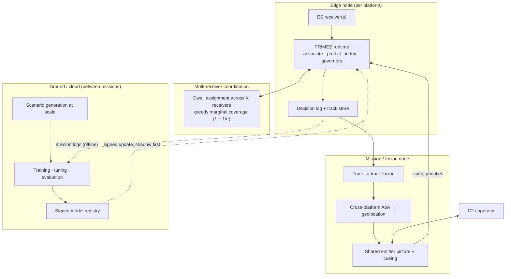

# PRIMES — Smart Scan Strategy for Electronic Warfare

**P**redictive **R**estless **I**ndex for **M**ultiband **E**lectronic **S**upport — a machine-learning Electronic Support (ES) receiver scheduler that learns *when* and *where* to look, with no prior intelligence on emitters.

> Sections follow the SIH submission structure: **Ideation → Technical Approach → Feasibility & Viability → Impact & Benefits → Research & References.**
> Every number marked *measured* comes from the committed benchmark (`artifacts/benchmark.json`) or from the dataset analysis in [`DATASET_NOTES.md`](DATASET_NOTES.md). What is built vs planned is listed in [`PRIMES_PROTOTYPE.md`](PRIMES_PROTOTYPE.md) and `PROGRESS.md`.
> Mermaid diagrams render on GitHub; paste a block into <https://mermaid.live> to export SVG/PNG for slides.

---

# 1. Ideation

## 1.1 The operational problem

An ES receiver on an aircraft, ship or ground station must maintain awareness of every radar around it across **0.5–18 GHz**, using a receiver whose instantaneous bandwidth is an order of magnitude smaller than the band it must cover. It therefore has to **sweep**, and every millisecond spent on one frequency is a millisecond not spent on the other 17 GHz.

Three physical facts make this hard:

1. **Emitters are only visible in bursts.** A rotating radar points its main beam at us for a short *flash* — tens of milliseconds every few seconds — and is invisible in between. Interception requires being on the right frequency *at the right instant*: a two-dimensional (frequency × time) coincidence problem.
2. **Emitters are agile.** They hop frequency, stagger or jitter their pulse intervals, and switch modes. What worked a second ago may not work now.
3. **There is no prior intelligence.** The problem statement explicitly removes the threat library that conventional scan plans depend on.

## 1.2 Why the current practice fails

Today's receivers use an **open-loop** plan: a fixed sweep, built from pre-mission data, optimised for raw speed. It ignores everything it learns during the mission. Two consequences, both measured in this project:

- **Wasted time.** Equal dwell is spent on silent bands and on active, threatening ones. Measured: the reference open-loop sweep intercepts only **~6 % of narrow main-beam flashes** and **11.5 % of all flashes** on real dataset scenarios.
- **Lock-out (synchronisation).** If the sweep period and a radar's rotation period are commensurate, the radar is **never** intercepted; if they are nearly commensurate, only on a very slow beat. Measured in our adversarial scenario: open-loop intercepts **1.0 %** of those flashes and finds **1 of 6** emitters in a minute. This is Clarkson's classical result, reproduced.

Scanning faster does not fix lock-out — it can cause it.

## 1.3 The insight the solution is built on

We measured the real emitter population (128,252 emitters from 2,500 scenarios) before designing anything. Two findings shaped the entire architecture:

1. **Scan periods are not arbitrary.** **96.2 % of radar scan periods fall on just 22 discrete values** (2 s, 10 s, 1 s, 4 s, 5 s, 2.5 s, …), because radars are built from a finite set of rotation rates. Within the 0.5–30 s range that matters for a short engagement, 19 values carry 96.3 % of the mass.
   → After a **single** catch, the question "when does this radar come back?" has ~19 candidate answers, not a continuum. One more catch, or a few well-placed misses, settles it.
2. **Real emitters are not all clean flashes.** In observed truth, the median emitter is receivable **32 % of the time** in long irregular stretches (sidelobes, wide beams, moving platforms); only **12 %** behave like short periodic flashes.
   → A single "periodic flash" model would be wrong for most of the population. Two competing models are needed per emitter.

**Therefore:** don't ask a neural network to rediscover radar physics from scratch. Model what is known (periodicity, on/off behaviour, detection geometry) explicitly and *learn the parameters online from hits and misses*, then let learning handle the residue.

> **Design principle:** do not use machine learning to rediscover everything from scratch when part of the problem can be modelled explicitly. Learning is applied where data beats assumptions: the emitter-population prior, the per-emitter timing posterior, the visibility factor, the dwell reliability, and (roadmap) a residual RL correction.

## 1.4 Alternatives considered and why they were rejected

| Alternative | Why not the answer |
|---|---|
| **Faster / optimised periodic sweep** (incl. Farey/Diophantine-optimal sweep periods) | Optimal only with a known threat list; the problem statement removes it. Retained as the **baseline** and as theory for the lock-out slide. |
| **Deep RL over raw observations (DQN/PPO)** — the common hackathon answer and the current published ES approach | Sample-hungry: a 30–60 s engagement gives ~7 flashes per emitter, and the first 2–3 must be enough. Opaque to an operator, no worst-case guarantee. **Measured**: our fairly-tuned Double-DQN reaches 15–21 % vs PRIMES' 60–80 %. |
| **Greedy / hit-rate bandit** | Cannot represent *phase*: it knows a band was productive, not *when* it will be productive. Measured 8–20 %. |
| **Exact POMDP solution** | Intractable at 36 centres × dozens of emitters with continuous timing state. |
| **Restless bandit with a Gilbert–Elliott channel model only** (classical dynamic spectrum access) | Right control paradigm, wrong emitter model: a rotating radar is not a two-state Markov channel. We keep the paradigm and replace the model. |

## 1.5 What is novel here

1. **Interval-censored learning of scan timing.** A miss is evidence, not a non-event: a look of length *d* that saw nothing rules out an interval of phase for every candidate period. Standard approaches (FFT/autocorrelation of arrival times) assume regular sampling and break on the sparse, censored, irregular looks a scanning receiver actually produces.
2. **A learned discrete prior over scan periods** (22 values, 96 % mass), fitted from an open dataset by streaming metadata — turning "unknown period" into a small hypothesis set that a couple of observations can resolve.
3. **Two competing emitter models per track**, periodic flash vs Gilbert–Elliott on/off, arbitrated by Bayes factors from the same hits and misses. This is what makes the system work on real data rather than only on idealised scanners.
4. **Value per unit receiver time**, not value per look: the scheduler compares "catch this emitter", "discover something new" and "learn a period" on one scale, divided by the time each option costs.
5. **A micro dwell controller**: looks end early once an emitter is confirmed, extend when they hear part of a flash, and are never used on emitters whose pulses are too sparse to confirm in that time. **Measured +5.8 points** mean interception and ~40 % faster first catch.
6. **Anti-synchronisation by construction**: dither in search mode, so the scheduler cannot fall into the lock-out trap that defeats open-loop sweeps.
7. **Explainability as a first-class output**: every dwell decision carries the numbers that produced it, which is what makes an ML scheduler acceptable on mission hardware.

---

# 2. Technical Approach

## 2.1 System overview

PRIMES is a closed loop: **observe → associate → predict → score → schedule → learn.**



**Layer contracts** (the reason the same core runs on a simulator, a recorded dataset or live hardware):

| Layer | Input → Output |
|---|---|
| L0 RF front-end | tune command `(centre, dwell)` → IQ samples |
| L1 Signal processing | IQ → PDW stream |
| L2 Association | PDWs → `(track_id, flash edges, parameters)` |
| L3 Emitter knowledge | associated flashes + misses → `p(band active at t)`, uncertainty, next-flash estimate |
| L4 Decision | beliefs + priorities → `(centre, dwell)` + explanation |
| L5 Learning | experience / corpora → priors, tuned parameters, residual policy |
| L6 Control & HMI | operator intent in; track picture and rationale out |

## 2.2 The scheduling loop, one decision at a time



## 2.3 The models

### Periodic flash model (rotating radars)
Emitter *e* illuminates us when `(t − φ) mod T < w`, for period `T`, phase `φ`, flash width `w`.

- **After one catch:** candidates are the ~19 discrete prior periods anchored at the observed flash.
- **After two catches** at `t₁ < t₂`: candidate periods are `(t₂ − t₁)/k`, refined by weighted least squares over all observed flashes.
- **Misses prune:** a look of length *d* that saw nothing removes a phase interval of width `d + w` from every surviving candidate. This is what kills sub-harmonics (2 s vs 4 s) that fit the hits equally well.
- **Uncertainty grows** with the number of unobserved periods, so predictions widen honestly when a track goes unwatched.

### Gilbert–Elliott on/off model (intermittently visible emitters)
A grid over mean on/off durations; the belief that an emitter is "on" relaxes towards its stationary value between looks and is updated on every look. This covers sidelobe visibility, sector scans and bursty modes — the 88 % of real emitters that are *not* clean flashes.

**Model arbitration:** the two classes compete through log-odds updated with the Bayes factor of every hit and miss, so each emitter ends up described by whichever model its own evidence supports.

### Undiscovered-emitter belief (the search term)
Per 250 MHz cell, an expected count of emitters not yet found:
- **thinned** by each look that covered it (Poisson thinning);
- **grown** by a pop-up hazard, so no band can be written off permanently;
- scaled by an **online-learned visibility factor κ**, fitted from how often looks actually discover new emitters. On real data κ settles at **4–10×**, i.e. real emitters are far more visible than metadata implies. Without it, PRIMES under-searches on real data (measured: discovery 22/35 → 34/35 emitters when κ was introduced).

## 2.4 The decision rule

For a dwell centre *c* and dwell length *d*:

$$
I(c,d)=\frac{\overbrace{\sum_{e\in\mathcal{E}(c)} W_e(t)\,P_e(\text{intercept in }[t,t+d])}^{\text{exploit known emitters}}+\overbrace{W_{\text{new}}\sum_{k\in\mathcal{K}(c)} m_k\,\bar P_{\text{det}}(d)}^{\text{discover new ones}}+\overbrace{\lambda\,IG(c,d)}^{\text{learn timing}}}{d+\tau\,\mathbb{1}[c\neq c_{\text{prev}}]}
$$

- **Value per unit time** makes 5 ms and 100 ms options comparable, and makes the retune cost `τ` explicit.
- **Overlap-aware coverage:** each centre accepts ±500 MHz, so neighbouring centres overlap; sums run over the *unique* tracks and cells a centre covers, never double-counting.
- **Staleness weight** `W_e(t)`: value grows with time since that emitter was last caught, so no single loud emitter can monopolise the receiver.
- **Resolution value:** a catch on an unconfirmed periodic track is worth its own flash *plus* the future flashes that confirming the period would unlock. This is what makes PRIMES invest two cheap looks now to own an emitter for the rest of the mission (measured: lock-out tracking 70 % → 95 %).
- **Appointments:** no dwell may run past a confident track's predicted flash unless it covers that emitter.
- **Information gain** `IG`: expected bits about the timing hypotheses, in closed form for a binary outcome. *Measured honestly: no significant effect at this scale — kept as an ablated component, not claimed as a source of gain.*

**Micro dwell controller** (measured +5.8 points, ~40 % faster first catch):
- **5 ms search looks** for a much faster sweep of the spectrum;
- **extend** a look that heard 1–2 pulses near its end, counting pulses across the contiguous window;
- **stop early** once an emitter is confirmed, returning the saved time to search;
- **reliability rule:** a dwell only counts as evidence about an emitter if it comfortably holds the pulses that emitter needs — otherwise a short look at a slow-pulsing emitter would wrongly "prove" it went quiet.

**Anti-synchronisation:** while tracking, look times are driven by predictions and are inherently aperiodic. The lock-out risk returns only in *search* mode, where a golden-ratio low-discrepancy dither breaks any commensurability with an emitter's rotation.

**Complexity and latency (design targets):** per decision the index costs `O(C·D·K̄·H)` — with 36 centres, 5 dwell options, ~3 tracks per centre and ~20 hypotheses ≈ 10⁴ arithmetic operations, i.e. **microseconds** in compiled form and well inside the shortest 5 ms dwell. Association is `O(n log n)` in pulses; predictor updates touch only the tracks a look covered.

## 2.5 Learning: what is learned, from what, and when



**Discipline:** scenario seeds are partitioned — evaluation 0–9, RL training 10 000+, validation 20 000+, and the three real-data tuning scenarios are disjoint from the eleven benchmark ones. Nothing is tuned on what is reported.

## 2.6 Scalability

| Dimension | How it scales | Evidence / mechanism |
|---|---|---|
| **Frequency coverage (C centres)** | index cost linear in C; coverage geometry is configuration, not code | 36 centres today; 0.5–18 GHz |
| **Dwell options (D)** | linear; 5 options now | micro controller adds the short end |
| **Emitters / tracks** | only tracks a centre covers are scored; negligible-weight hypotheses pruned | validated at 100 emitters/scenario |
| **Receivers per platform (K)** | assign the K best dwells by *marginal* coverage gain — a submodular problem with a `1 − 1/e` guarantee | design in place; single receiver measured |
| **Platforms** | tracks fused at a mission node; each edge keeps scheduling autonomously — no central bottleneck in the control loop | fusion interface defined |
| **Compute at the edge** | ~10⁴ ops per decision; NumPy today, ONNX/C++ port path for embedded SoC | decision ≪ 5 ms dwell |
| **Training / evaluation** | embarrassingly parallel; checkpointed and resumable; cloud GPU only for RL | 610-run benchmark, 3–6 workers |
| **Data volume** | dataset metadata streamed (no 70 GB download); pulse data cached once, replayed many times | priors fitted in ~10 min over the network |
| **Software** | stateless API with on-disk run cache; deterministic replay makes any result reproducible from a seed | `POST /api/runs` cached by content hash |

## 2.7 Security, safety and trust

A learned scheduler on mission hardware must answer "how can this fail, and who can make it fail?"

**Operational security**
- **Passive by construction.** ES is receive-only: PRIMES emits nothing, so it adds no probability of intercept or geolocation risk for own platform.
- **Unpredictability.** Search-mode dither means the look sequence is not a fixed pattern an adversary could model even with knowledge of the algorithm.

**Adversarial robustness (the ML-specific threat)**
- **Bait/decoy emitters** designed to monopolise a learned scheduler: bounded by the **staleness weight** (an emitter's value decays right after it is caught) and by a **cap on the share of receiver time any one track can draw**.
- **Denial by false alarms / jamming:** false detections enter a clutter track; the miss/hit evidence is floored so no single observation can veto a hypothesis; κ and dwell-reliability estimators are clipped to sane ranges.
- **Blind-spot creation:** the **staleness governor** enforces a hard maximum revisit interval per band — a deterministic guarantee that no band goes unobserved beyond `τ_crit`, independent of what the learned layer wants.
- **Model poisoning via field logs:** logs refit *priors* only, offline, with censoring-aware estimation and human review; they never rewrite a live policy.

**Functional safety**
- **Deterministic fallback:** if the learned layer is unavailable or faults, the analytic index runs alone; if priors are missing, flat priors apply; ultimately a fixed raster sweep is always available.
- **Shielded learning:** any residual RL policy is clamped so its choice cannot fall below the analytic policy's value by more than a set margin (roadmap component, designed in).
- **Bounded compute:** fixed-size hypothesis banks (pruned) and a fixed action set give a hard upper bound on per-decision work — no unbounded search at runtime.

**Software and supply-chain security**
- **Offline by default:** no network calls in the scheduling loop; dataset access is needed only to refit priors, on a development machine.
- **Signed, versioned artefacts** (`priors.json`, index parameters, policy weights) in a registry; **shadow-mode** evaluation before a new artefact is allowed to act; rollback is a version change.
- **Pinned dependencies**, reproducible environment, permissive open-source licences only (dataset: Apache-2.0).
- **Deterministic replay + full decision logs** give a tamper-evident audit trail: any mission can be re-run bit-for-bit from its seed and inputs, and every dwell has a recorded rationale — essential for accident investigation and for acceptance testing.

**Data handling**
- Mission data stays at the edge; only aggregated, non-attributable statistics need ever leave it.
- Development used open synthetic data, so no classified material is embedded in the models.

## 2.8 Deployment architecture



**Tiering:** the edge loop is fully autonomous and works comms-denied; coordination and fusion improve it when available; the ground tier never participates in a real-time decision.

## 2.9 Technology stack

| Concern | Choice | Why |
|---|---|---|
| Core | Python 3.12 + NumPy | vectorised, portable, no exotic dependencies |
| Environment | Gymnasium | standard RL interface for the comparator |
| Learned comparator | Stable-Baselines3 (Double-DQN), PyTorch | credible published baseline |
| Data | huggingface_hub (streaming), h5py | metadata without bulk download |
| Backend | FastAPI + Uvicorn | typed, async, trivial to containerise |
| Frontend | Next.js (React, TypeScript), canvas/SVG | interactive replay; no chart library to audit |
| Reproducibility | pytest (20 tests), seeded replay, checkpointed benchmark | every figure regenerable |
| Edge path | ONNX export; NumPy/C++ port of the index loop | embedded SoC / FPGA-class targets |

---

# 3. Feasibility & Viability

## 3.1 Technical feasibility — already demonstrated

Not a proposal: a working prototype with measured results.

| Evidence | Status |
|---|---|
| Receiver model reverse-engineered from an open dataset | ✅ explains **99.987 %** of 22.7 M pulses |
| Population priors fitted from 128,252 emitters | ✅ **96.2 %** of periods on 22 values |
| Scheduler implemented end-to-end with two emitter models | ✅ 20 unit tests |
| Benchmark vs 4 baselines + a trained Double-DQN + clairvoyant upper bound | ✅ 549 runs with 95 % bootstrap CIs (610-run refresh in progress) |
| Validation on **real dataset scenarios** (not only our simulator) | ✅ 11 scenarios, 35–100 emitters each |
| Interactive demo (replay + benchmark pages) | ✅ FastAPI + Next.js |

**Headline measured results** (previous full benchmark; the micro dwell controller adds a further **+5.8 points** mean on held-out tuning scenarios and is being re-benchmarked):

| Scenario | Open-loop raster | Greedy bandit | Double-DQN | **PRIMES** | Clairvoyant oracle |
|---|---|---|---|---|---|
| lock-out | 1.0 % | 7.6 % | 5.8 % | **60.2 %** | 98.3 % |
| easy | 5.6 % | 14.4 % | 4.4 % | **65.5 %** | 96.1 % |
| pop-up | 5.8 % | 10.8 % | 5.3 % | **57.9 %** | 97.6 % |
| dense (40 emitters) | 9.9 % | 20.3 % | 20.7 % | **65.2 %** | 89.9 % |
| mixed periodic + intermittent | 14.1 % | 17.2 % | 10.3 % | **79.1 %** | 94.3 % |
| **real dataset scenarios** | 16.8 % | 20.3 % | 15.3 % | **64.5 %** | 84.8 % |

Supporting measurements: **92 % of lock-out emitters discovered** (raster 15 %); **89–100 %** of next-flash predictions within 10 ms on periodic emitters; **95–99.5 %** of an emitter's flashes caught once it is tracked; time to first catch on lock-out **55.7 s → 24.2 s** (and **→ 14.7 s** with the micro controller).

## 3.2 What the numbers do *not* claim

- The clairvoyant oracle (85–98 %) is **not** an achievable target: it is handed the truth.
- The residual ~20 % gap on simulated scenarios is dominated by flashes that occur **before** a blind search first finds an emitter — a physical limit of one narrowband receiver, not a tuning failure.
- The information-gain term shows **no measurable benefit**; three other ideas (frequency-seeded search, faster revisits for intermittent emitters, a per-discovery bookkeeping change) were measured and **rejected**. Reporting them is deliberate: it shows the tuning was evidence-driven.

## 3.3 Resource feasibility

| Resource | Requirement |
|---|---|
| Development compute | a laptop; the full 610-run benchmark takes ~45 min on 3 cores; DQN training ~25 min on CPU |
| Runtime compute (target) | ~10⁴ operations per decision; fits a modest embedded CPU. Python prototype currently takes 25–50 s per 30 s scenario — a **porting** task, not an algorithmic one |
| Data | open, Apache-2.0 licensed; metadata streamed, no bulk storage needed |
| Licences / cost | zero: entirely open-source stack, no proprietary toolchain |
| Skills | signal processing + applied Bayesian inference + ordinary web/backend engineering |

## 3.4 Risks and mitigations

| Risk | Likelihood | Mitigation |
|---|---|---|
| **Real deinterleaving is imperfect** (prototype assumes emitter identity is resolved upstream) | High | The dataset used exists precisely to benchmark deinterleavers; a learned or classical deinterleaver plugs into L2. Evaluate with a truth-association oracle to bound the loss. |
| **Real-time budget on embedded hardware** | Medium | Bounded per-decision cost by design; ONNX/C++ port; hardware-in-the-loop test on an SDR |
| **Domain gap between simulator and a specific platform** | Medium | Validated on an independent dataset already; simulator parameters are fitted, not invented; priors refit per theatre |
| **Adversary exploits the learned behaviour** | Low–Medium | Staleness governor, dither, per-track time caps, evidence floors (§2.7) |
| **Evaluator scepticism of "AI in the loop"** | Medium | Deterministic fallback, per-decision explanations, replayable audit trail, and a measured comparison against a fairly-tuned DQN |
| **Long-period emitters (≥ 15 s) cannot be learned in a short engagement** | Certain (physics) | Fall back to the search prior; metrics stratified so the limitation is visible, not hidden |

## 3.5 Path from prototype to fielded capability

| Stage | Work | Indicative effort |
|---|---|---|
| **Now (TRL 3–4)** | Algorithm + simulator + dataset validation + demo | done |
| **TRL 4–5** | Real deinterleaving in the loop; hardware-in-the-loop with an SDR (RFSoC/USRP class); latency port to C++/ONNX; recorded-signal replay | 3–6 months |
| **TRL 5–6** | Integration with an existing ESM suite as a scheduling module; multi-receiver coordination; trials against instrumented emitters | 6–12 months |
| **TRL 6+** | Multi-platform fusion; certification evidence pack (determinism, fallback, audit); field trials | 12+ months |

**Viability as a product:** PRIMES is a **software upgrade to existing receivers** — same antenna, same front-end, better decisions. That is the cheapest possible path to capability, and it degrades gracefully to today's behaviour if switched off.

---

# 4. Impact & Benefits

## 4.1 Operational impact

| Effect | Measured |
|---|---|
| **More of the electromagnetic picture** | 3.8× more radar flashes intercepted than the open-loop sweep on real scenarios (64.5 % vs 16.8 %) |
| **Blind spots eliminated** | lock-out emitters go from 1 % of flashes and 1-in-6 discovered, to 60 %+ and 6-in-6 |
| **Earlier warning** | time to first catch cut by up to 3.8× on adversarial cases (55.7 s → 14.7 s) |
| **Better emitter parameters** | 95–99.5 % of a tracked emitter's flashes are caught, so PRI/scan/agility estimates rest on far more samples |
| **Operator trust** | every dwell decision is explained in one line; the learned period of each radar is displayed against truth in the demo |

Why each matters operationally: an ES system exists to answer *what is out there, where, and is it a threat now*. Flashes are the raw evidence for all three. Catching ~4× more of them, and catching the radars that a fixed sweep structurally cannot see, changes the quality of the tactical picture rather than just a metric.

## 4.2 Economic and programmatic benefits

- **No new hardware:** a scheduling-software change to fielded receivers.
- **Fleet-wide upgrade path:** one validated artefact set can be deployed to many platforms; behaviour is reproducible and auditable.
- **Lower operator workload:** the scheduler handles search/track balance that operators currently manage by choosing sweep plans.
- **Cheap to develop and maintain:** open-source stack, no licence costs, an automated benchmark that regenerates every figure from seeds.

## 4.3 Strategic benefits

- **Works without a threat library** — exactly the case where imported, pre-programmed scan plans fail, and the case the problem statement targets.
- **Indigenous and adaptable:** priors are refitted from locally observed populations; nothing depends on a foreign threat database.
- **Transparent AI for defence:** explanations, deterministic fallback and replayable audit make it acceptable where black-box RL would not be.

## 4.4 Wider applications

| Domain | Use |
|---|---|
| Spectrum monitoring / regulation | find intermittent or unlicensed transmitters with limited receivers |
| Interference hunting | telecom operators tracking sporadic interferers |
| Radio astronomy / RFI mitigation | schedule monitoring of a wide band with narrow instruments |
| Search problems in general | the same "predict → value per unit time → schedule" pattern fits sensor scheduling, inspection routing and anomaly sweeps |

---

# 5. Research & References

## 5.1 Prior art we build on

| Reference | What we take from it |
|---|---|
| A. G. Self, B. G. Smith, *Intercept time and its prediction*, IEE Proc. F, 1985 | Classical probability-of-intercept theory; used to validate the simulator's intercept statistics |
| I. V. L. Clarkson, *Optimisation of periodic search strategies for electronic support*, IEEE Trans. AES, 2011 | Synchronisation / lock-out of periodic sweeps (Farey ratios); motivates our adversarial scenarios and the anti-sync dither |
| I. V. L. Clarkson, *Sensor scheduling for electronic support to intercept beam-agile radar*, IET RSN, 2019 | Periodic vs stochastic emitter models for scheduling |
| I. V. L. Clarkson, *Approximate ML period estimation from sparse, noisy timing data*, IEEE Trans. SP, 2008; McKilliam & Clarkson, ICASSP 2008 | Period estimation from sparse irregular observations — the basis for our censored candidate-and-refit estimator |
| K. Liu, Q. Zhao, *Indexability of restless bandit problems and optimality of Whittle index for dynamic multichannel access*, IEEE Trans. IT, 2010 | The restless-bandit index paradigm and the Gilbert–Elliott channel model |
| *Restless bandits with imperfect binary feedback: PCL-indexability*, arXiv:2606.11192 | Index theory under missed detections and false alarms |
| Nakhleh et al., *NeurWIN: Neural Whittle Index Network*, NeurIPS 2021 | Learned index policies — the roadmap route for a residual learner |
| Russo & Van Roy, *Learning to optimize via information-directed sampling*, Operations Research, 2018 | Information-value term in the score |
| *Machine Learning-based Receiver Scheduling for Electronic Support* (Double-DQN), IEEE Xplore 11310649 | The current published ML approach — reimplemented as our comparator |
| The Alan Turing Institute, *The Turing Synthetic Radar Dataset*, arXiv:2602.03856 | Independent emitter population and ground truth |
| *Radar Pulse Deinterleaving with Transformer-Based Deep Metric Learning*, arXiv:2503.13476 | Route to replacing the ideal-association assumption |
| RFRL Gym (Virginia Tech NSI), arXiv:2401.05406 | Reference point for RF RL environments |

## 5.2 Our own measurements (reproducible from this repository)

| Finding | Method | Where |
|---|---|---|
| Reference receiver: 36 centres, ±500 MHz acceptance, fixed 2.15 s cycle — explains 99.987 % of 22.7 M pulses | replay of the published schedule against 250 scan-mode files | `scripts/inspect_turing_dataset.py`, `DATASET_NOTES.md` |
| 96.2 % of scan periods on 22 discrete values (128,252 emitters) | metadata streamed from 2,500 training scenarios | `primes/data/fit_priors.py` |
| Real emitters: median 32 % visibility duty; only 12 % flash-like | illumination analysis of stare-mode truth | `DATASET_NOTES.md` |
| Open-loop intercepts 6.3 % of narrow flashes / 11.5 % of all | exact replay of the real schedule on 11 scenarios | `DATASET_NOTES.md` |
| PRIMES vs 4 baselines + DQN + oracle, 6 scenario families, bootstrap CIs | 549-run benchmark (610-run refresh in progress) | `experiments/benchmark.py`, `artifacts/benchmark.json` |
| Component attribution: learned prior +20 points; information gain no effect; 4 further ideas measured and rejected | ablations and variant sweeps on disjoint tuning scenarios | `experiments/compare_variants.py`, `PROGRESS.md` |

## 5.3 Reproducibility

```bash
pip install -r requirements.txt
pytest -q                                      # 20 tests
python -m experiments.benchmark --seeds 10     # regenerates artifacts/benchmark.json
uvicorn api.main:app --port 8000               # backend
cd web && npm install && npm run dev           # demo at localhost:3000
```

Every result is a deterministic replay from a seed; the benchmark checkpoints each run and resumes if interrupted.
