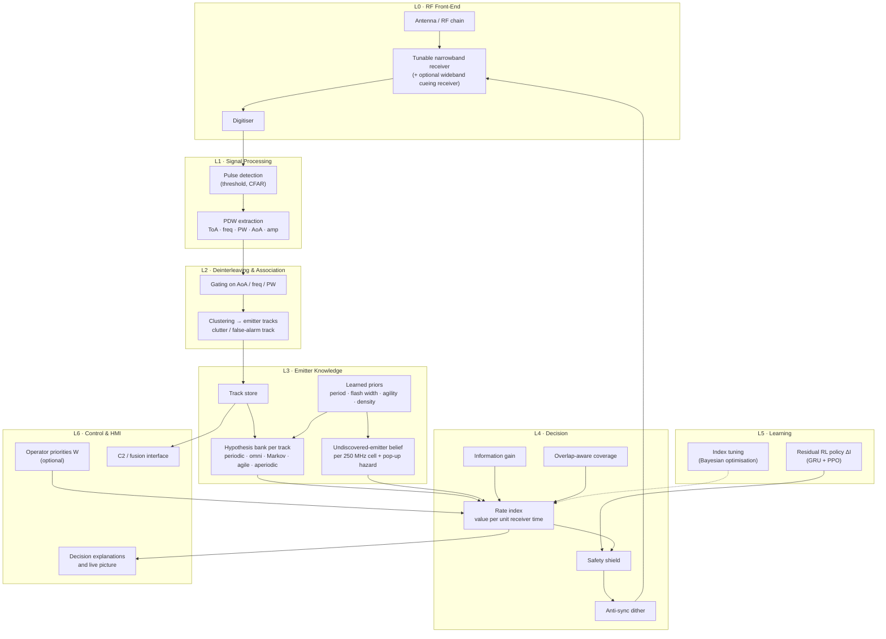
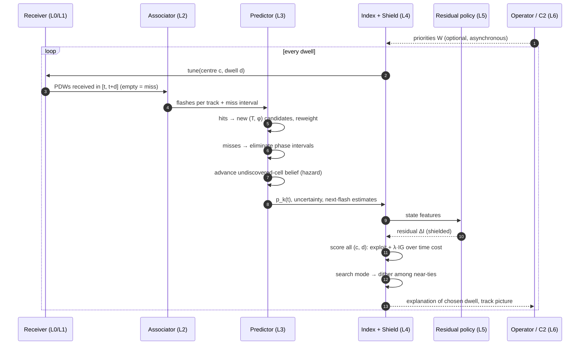
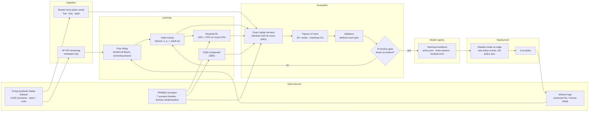
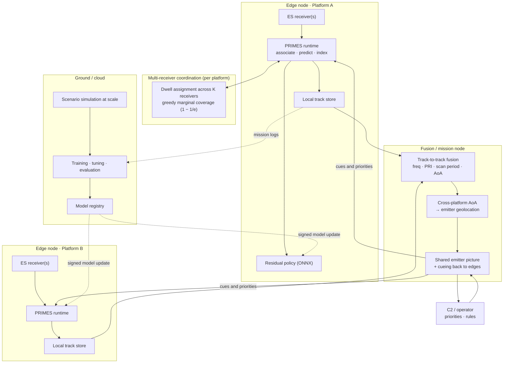

# PRIMES — Full Solution & Scalable Architecture

**P**redictive **R**estless **I**ndex for **M**ultiband **E**lectronic **S**upport. A machine-learning Electronic Support (ES) receiver scheduler that learns *when* and *where* to look, with no prior intelligence on emitters.

> This document is the complete design (PPT content). What the demo prototype implements is in [`PRIMES_PROTOTYPE.md`](PRIMES_PROTOTYPE.md). The status table at the end maps each component to *prototype* or *roadmap*.
>
> Mermaid diagrams render on GitHub. To export them for slides, paste each block into <https://mermaid.live> and download SVG or PNG.

---

## 1. Problem

- **Wide spectrum, narrow receiver.** An ES receiver must watch 0.5–18 GHz with an instantaneous bandwidth an order of magnitude narrower, so it has to sweep.
- **Open-loop scanning is the norm.** A fixed sweep built from pre-mission data, optimised only for speed.
- **Failure 1 — wasted time:** equal dwell on silent or benign bands and on new or threatening ones.
- **Failure 2 — synchronisation (lock-out):** a periodic sweep against a periodically scanning radar can *never* see it if the periods are commensurate, or only on a very slow beat if they are nearly so.
- **No prior intelligence:** the problem statement requires the scheduler to cope without a threat library.

### What the data says (Turing Synthetic Radar Dataset, measured by us)

| Finding | Value |
|---|---|
| Typical emitter as seen by an ES receiver | a **main-beam flash of ~14 ms every ~4 s** (median) |
| Flash width range | 0.33 ms – 42 ms (p90) |
| Scan period range | 0.5 s – 15 s (p90), tail to 600 s |
| Emitters per scenario | median 51, up to 100 |
| Open-loop reference receiver (reverse-engineered) | 36 dwell centres, **±500 MHz acceptance**, fixed **2.15 s** cycle of 50 / 100 ms dwells, explains **99.987 %** of 22.7 M pulses |
| Dwell time covering any given frequency (2–3 overlapping dwells) | 50–200 ms per 2.15 s cycle (median 100 ms) |
| **Open-loop raster: flashes intercepted** (measured: real schedule replayed on 11 Turing stare scenarios, ≥ 3-pulse detection) | **≈ 6 %** of narrow main-beam flashes (< 50 ms); 11.5 % of all flashes including broad-beam and omni |
| Receiver time needed to *track* one known emitter | **≈ 0.6 %** (estimate: a 25 ms look every 4 s) |

**Insight:** once an emitter's period and phase are known, following it is almost free, so most receiver time can go to search. The hard part is *learning* timing from the few flashes a 30 s engagement provides (~7 per emitter). That calls for an explicit, sample-efficient model, with learning layered on top.

---

## 2. Solution overview

> **Design principle: do not use machine learning to rediscover everything from scratch when part of the problem can be modelled explicitly.**

PRIMES is a closed-loop, **observe → associate → predict → index → schedule → learn** system:

1. **Associate** received pulses into emitter tracks.
2. **Predict** each track's next flash (period, phase, width) from sparse, *censored* hits and misses, with calibrated uncertainty. Also estimate where *undiscovered* emitters are likely to be.
3. **Index** every possible dwell (frequency centre × dwell length) by **value per unit receiver time**: intercept value + information value, divided by time cost.
4. **Schedule** the best dwell, using anti-synchronisation dither when searching blind.
5. **Learn:** priors fitted from data, index weights tuned, and a residual RL policy that corrects the analytic index behind a safety shield.

**Why it beats the alternatives:**

| Approach | Limitation | PRIMES answer |
|---|---|---|
| Open-loop / Farey-optimised sweep | needs a known threat list; lock-out | learns periods online; dither breaks synchronisation |
| Greedy on a belief state | cannot represent phase; under-explores | per-track phase model + information gain |
| Deep Q-Network scheduler (published ML approach) | sample-hungry, opaque, no worst-case bound | explicit model learns from 2–3 flashes; interpretable index; RL only as a shielded residual |
| Full POMDP | intractable at scale | index policy (restless-bandit theory), near-linear per-decision cost |

---

## 3. Architecture view 1 — Logical / layered

**Layer responsibilities and interfaces:**

| Layer | Responsibility | Input → Output |
|---|---|---|
| L0 RF front-end | tune to centre `c` for dwell `d` | tune command → IQ samples |
| L1 Signal processing | detect pulses, measure parameters | IQ → PDW stream |
| L2 Association | group PDWs by emitter | PDWs → `(track_id, flash_edges, params)` |
| L3 Emitter knowledge | temporal belief per track and per cell | associated flashes + misses → `p_k(t)`, uncertainty, next-flash estimate |
| L4 Decision | choose the next dwell | beliefs, priorities → `(centre, dwell)` + explanation |
| L5 Learning | improve the decision layer | experience, scenarios → tuned parameters, residual `ΔI` |
| L6 Control & HMI | human intent and situational awareness | priorities in; track picture and explanations out |

**Why it scales:**
- **Stable interfaces:** the layers talk through fixed interfaces. The same L3–L5 stack runs whether PDWs come from a simulator, a recorded dataset or live hardware.
- **Pluggable predictor:** new emitter types are new hypotheses in L3, with no change to L4.
- **Hardware-independent decision layer:** L4 needs only `(centre, dwell)` and the coverage model, so a different receiver (more centres, other bandwidths) is a configuration change.

---

## 4. Architecture view 2 — Runtime decision loop

### Core equations

**Periodic flash model.** Track `e` illuminates the receiver iff `(t − φ) mod T < w`.

**Interval-censored evidence:**
- A **hit** gives flash-edge times, and two hits give period candidates `T ∈ {(t₂ − t₁)/k}`.
- A **miss** over `[s, s+d]` removes phase interval `d + w` from every candidate.

**Cell prediction:**

$$
p_k(t) = 1 - (1 - q_k\,\bar p_{\text{new}}) \prod_{e \in k} \big(1 - p_e(t)\big), \qquad p_e(t)=\sum_h w_h\,p_{e,h}(t)
$$

**Undiscovered-emitter belief:**
- After a miss, `q_k` falls by the average detection chance under the prior.
- Between looks it rises: `q_k ← 1 − (1 − q_k)·e^{−ρΔt}`.

**Rate index** for dwell centre `c` and dwell length `d`:

$$
I(c,d) = \frac{\sum_{e \in \mathcal{E}(c)} W_e(t)\,P_e(\text{intercept in }[t,t+d]) + \sum_{k \in \mathcal{K}(c)} W_{\text{new}}\,q_k\,\bar P_{\text{det}}(d) + \lambda\,IG(c,d)}{d + \tau\,\mathbb{1}[c \ne c_{\text{prev}}]}
$$

**Information gain** (binary outcome, closed form):

$$
IG = H\Big(\sum_h w_h p_h\Big) - \sum_h w_h H(p_h)
$$

**Residual learning:**

$$
I^{\text{final}} = I^{\text{analytic}} + \Delta I^{\text{RL}}
$$

The shield bounds how far `I^final` may diverge from the analytic choice.

### Timing budget (design targets)

| Step | Complexity | Target |
|---|---|---|
| Association of one dwell's PDWs | O(n log n) pulses | < 1 ms |
| Predictor update | O(H) hypotheses per touched track | < 0.5 ms |
| Index over all actions | O(C · D · K̄ · H), e.g. 36 × 4 × 3 × 20 ≈ 9k evaluations | < 1 ms |
| Residual policy (small GRU, ONNX) | fixed | < 1 ms |
| **Decision latency** | | **≪ shortest dwell (10 ms)** |

**Physics of the gain (estimates):**
- **Search:** per unit of receiver time, a dwell of length `d` catches an unknown-phase flash at rate `(d + w) / (T·(d + τ))`. With `w` = 14 ms and `τ` = 1 ms, 10 ms dwells search ~**2×** more efficiently than 100 ms dwells.
- **Tracking:** once a track is locked, interception of its flashes approaches 100 % at ~0.6 % receiver-time cost.

---

## 5. Architecture view 3 — Data & ML lifecycle

**Lifecycle stages:**

| Stage | What happens | Output |
|---|---|---|
| Ingest | stream Turing metadata through the HF API; cache pulse data once for validation and test splits | emitter-parameter corpus, replayable truth |
| Simulate | generate scenario families (easy, shared-band, agile, lock-out exact/near, pop-up, dense) with domain randomisation | training and evaluation truth |
| Fit priors | empirical-Bayes distributions over period, flash width, agility, density from 2,500 training scenarios | `priors.json` |
| Tune | Bayesian optimisation of index parameters, on training scenarios only | index parameters |
| Train | residual PPO policy and DQN comparator on cloud GPU | `residual.onnx`, `dqn.zip` |
| Evaluate | exact replay on identical truth; 30+ seeds; bootstrap CIs; stratified by emitter period and band occupancy | metrics report |
| Ablate | remove one component at a time | attribution of improvement |
| Promote | registry versioning; shadow deployment before activation | live policy |
| Feedback | field logs of censored hits and misses re-fit priors, keeping the "trained on hits and misses" loop closed | updated priors |

**Data discipline:**
- **Splits:** train, validation and test are kept separate, and nothing is tuned on test.
- **Exact replay:** the simulator and dataset give full truth, so policies are compared exactly.
- **Field logs:** logs are censored, so they update priors with censoring-aware estimation and are never used as exact replay truth.

---

## 6. Architecture view 4 — Scalable deployment

### Deployment tiers

| Tier | Runs | Link dependency |
|---|---|---|
| **Edge node** (per platform) | full PRIMES loop; decision latency below the dwell time; embedded CPU / SoC (FPGA-SoC or GPU-SoC class) | **none**: fully autonomous in comms-denied conditions |
| **Multi-receiver coordination** | assigns dwells across K receivers on one platform by marginal coverage gain | local bus |
| **Fusion / mission node** | fuses tracks across platforms, geolocates by AoA triangulation, cues edges with discovered emitters | tactical data link, opportunistic |
| **Ground / cloud** | large-scale simulation, training, evaluation, model registry | offline / between missions |

### Scaling dimensions

| Dimension | How PRIMES scales |
|---|---|
| **Frequency coverage / dwell centres (C)** | index cost linear in C; coverage model is configuration |
| **Dwell options (D)** | linear in D |
| **Emitters / tracks** | only tracks inside a centre's coverage are scored: O(C·D·K̄), with K̄ the average tracks per centre |
| **Hypotheses (H)** | pruned candidate sets; new emitter types added as plug-in hypotheses |
| **Receivers per platform (K)** | greedy submodular assignment, O(K·C·D), `(1 − 1/e)` optimality guarantee |
| **Platforms** | tracks fused at the mission node; edges stay independent, so there is no central bottleneck in the loop |
| **Training scale** | embarrassingly parallel simulation; cloud GPU for RL |
| **Model updates** | versioned, signed artefacts; shadow mode before activation; the shield bounds any new policy against the analytic index |

**Resilience:**
- **Comms-denied:** every edge runs standalone, and the fusion node only improves it.
- **Graceful degradation:** if the residual policy is unavailable, the analytic index runs alone. If priors are unavailable, flat priors apply.
- **Safety:** the shield prevents a learned update from performing worse than the analytic scheduler beyond a set margin.

---

## 7. Algorithms in depth (slide notes)

### 7.1 Association
- **MVP:** gate on frequency window, PW class and AoA sector, then DBSCAN. Unassociated singletons go to a clutter track, which absorbs false alarms.
- **Advanced:** learned pulse embeddings (transformer metric learning, as benchmarked on the Turing deinterleaving challenge).
- **Why it matters:** bands are shared (≈ 51 emitters over 36 centres), so a per-band model fails when two scanners share a band.

### 7.2 Temporal prediction
- **Hypotheses:** periodic flash (circular scan), continuous (omni), Gilbert–Elliott Markov, frequency-agile (hop set across cells), aperiodic / Poisson.
- **Before the second hit:** the track is a prior mixture over period, so predictions are smooth.
- **Two hits:** candidate periods `(t₂ − t₁)/k`. Misses prune candidates; further hits refine them. Research version: lattice ML period estimation (Clarkson–McKilliam).
- **Model selection:** Bayesian posterior over hypothesis classes.
- **Outputs:** next-flash time, probability, uncertainty. These drive the *percentage of correct predictions* and *average intercept time error* metrics.

### 7.3 Decision index
- **Rate form:** value per unit receiver time, so dwell lengths compare fairly.
- **Staleness weight:** `W_e(t) = W_threat,e · g(time since last intercept)` rewards refreshing tracks and prevents farming one emitter.
- **Coverage:** counts unique tracks and cells per centre, so ±500 MHz overlaps are never double-counted.
- **Research extension:** a Whittle / marginal-productivity index with numerical indexability checks (restless-bandit theory; PCL for imperfect feedback).

### 7.4 Anti-synchronisation
- **When lock-out happens:** a fixed revisit period `T_c` against scan period `T_s`. Exact commensurability means never; near-commensurability means a slow beat. Example: `T_s` = 2.20 s vs `T_c` = 2.15 s with ~100 ms covering dwell gives a worst-case wait ≈ **80–90 s**, longer than the whole 30 s engagement.
- **Tracking needs no dither:** look times are driven by predictions, so they are not periodic.
- **Search mode:** golden-ratio low-discrepancy tie-breaking, randomised dwell start offset, and a commensurability check against the period prior.
- **Theory slide:** Farey-sequence synchronisation ratios for periodic sweeps (Clarkson) show why no single fixed sweep period is safe against an unknown emitter set.

### 7.5 Residual RL with shield
- **Policy:** a GRU policy observes belief features and outputs `ΔI` per action; trained with PPO under domain randomisation.
- **Shield:** the final action's analytic value must be within margin ε of the analytic best.
- **Evaluation:** on held-out scenario families, to show whether gains generalise.

---

## 8. Figures of merit (mapped to the problem statement)

| Problem statement asks for | PRIMES metric |
|---|---|
| Probability of detection | P_d vs sensitivity and dwell (ROC) |
| Probability of false alarm | P_fa sweep; clutter-track rate |
| Sensitivity | performance-vs-sensitivity curves |
| Average intercept rate | intercepts per second |
| Average reward / cost function | threat-weighted intercept value per unit receiver time |
| Percentage of correct predictions | next-flash predictions within tolerance |
| Average intercept time error | mean ‖predicted − actual next flash‖ |
| Intercept time / interception ratio | time to first intercept (mean, p95, worst); fraction of flashes intercepted |
| *(added)* optimality | regret vs clairvoyant oracle |
| *(added)* new-threat responsiveness | pop-up emitter latency |
| *(added)* fairness | coverage across emitters |

All metrics are reported over 30+ seeds with bootstrap confidence intervals, stratified by emitter period relative to the observation window.

---

## 9. Validation methodology

1. **Exact replay:** every policy runs against identical stored truth.
2. **Bounds:** open-loop Turing schedule as the floor, clairvoyant oracle as the ceiling.
3. **Adversarial scenarios:** exact and near-commensurate lock-out, pop-up emitters, dense shared bands.
4. **External data:** replay on Turing stare-mode truth; statistical cross-check of the simulated open-loop sweep against Turing scan-mode data.
5. **Analytic cross-check:** simulator intercept times vs closed-form probability-of-intercept theory (Self, 1985).
6. **Ablations:** no prediction · no IG · flat vs learned priors · per-band vs per-track · no pop-up hazard · no dither · no expanded hypotheses · +RL residual.

---

## 10. Technology stack

| Concern | Choice |
|---|---|
| Core | Python 3.12, NumPy, Numba |
| Environment | Gymnasium |
| RL / ML | Stable-Baselines3 (DQN, PPO), PyTorch, ONNX Runtime |
| Tuning | Optuna |
| Data | huggingface_hub (streaming), h5py, Parquet cache |
| Config / experiments | Hydra, pytest |
| Visualisation / demo | Streamlit, Plotly |
| Edge path | ONNX-exported residual policy; NumPy / C++ port of the index loop |

---

## 11. Feasibility, risks, mitigations

| Risk | Mitigation |
|---|---|
| Association errors in dense bands | clutter track; evaluation with a truth-association mode bounds the loss |
| Long-period emitters (≥ 15 s) give too few flashes to learn | search-prior fallback; metrics stratified by period |
| RL gives little gain over the analytic index | RL is a residual extension; the analytic scheduler stands on its own |
| Learned policy misbehaves after an update | shield + shadow mode + registry rollback |
| Dataset built for deinterleaving, not scheduling | used for realism, priors and statistical validation; simulator for control |

---

## 12. Impact & applications

- **Airborne / naval / ground ESM:** faster first intercept of new threats; more intercepts of known emitters for tracking and identification.
- **Multi-platform ISR:** shared emitter picture, AoA geolocation, cueing.
- **Spectrum monitoring (civil):** the same scheduler finds intermittent or illegal transmitters with limited receivers.
- **Operator trust:** every dwell decision comes with an explanation.
- **Doctrine-independent:** works without a threat library, and uses one if available through priority weights and priors.

---

## 13. Roadmap

| Phase | Content |
|---|---|
| 1 | Simulator, receiver model, pulse-level truth, replay |
| 2 | Baselines (raster, random, greedy, oracle), metrics |
| 3 | Predictive MVP: periodic tracks, undiscovered belief, learned priors |
| 4 | Rate index, information gain, dither, tuning; DQN comparison |
| 5 | Expanded hypotheses: Markov, agile, aperiodic, omni |
| 6 | Residual RL + shield; held-out generalisation |
| 7 | Turing validation, ablations, report |
| 8 | Multi-receiver coordination, fusion node, edge port (ONNX / C++) |

---

## 14. Implementation status

| Component | Status |
|---|---|
| Turing dataset analysis and receiver reverse-engineering | ✅ done |
| Simulator (periodic emitters, Turing receiver) | 🧪 prototype |
| Baselines: raster, random, greedy, oracle | 🧪 prototype |
| PRIMES-lite: periodic tracks, undiscovered belief, rate index + IG, dither | 🧪 prototype |
| Core metrics + Turing replay on sample scenarios | 🧪 prototype |
| Live demo UI | 🧪 prototype |
| Learned association, expanded hypotheses | 🗺️ roadmap |
| DQN comparator, residual RL + shield | 🗺️ roadmap |
| Full ablations, stratified statistics | 🗺️ roadmap |
| Multi-receiver, fusion, edge deployment, MLOps | 🗺️ roadmap |

---

## 15. References

- I. V. L. Clarkson, "Optimisation of periodic search strategies for electronic support," *IEEE Trans. AES*, 2011.
- I. V. L. Clarkson, "Sensor scheduling for electronic support to intercept beam-agile radar," *IET RSN*, 13, 2019.
- I. V. L. Clarkson, "Approximate maximum-likelihood period estimation from sparse, noisy timing data," *IEEE Trans. SP*, 2008; R. G. McKilliam, I. V. L. Clarkson, "Maximum-likelihood period estimation from sparse, noisy timing data," *ICASSP*, 2008.
- A. G. Self, B. G. Smith, "Intercept time and its prediction," *IEE Proc. F*, 1985.
- K. Liu, Q. Zhao, "Indexability of restless bandit problems and optimality of Whittle index for dynamic multichannel access," *IEEE Trans. IT*, 2010.
- "Restless bandits with imperfect binary feedback: PCL-indexability analysis and computation," arXiv:2606.11192.
- K. Nakhleh et al., "NeurWIN: Neural Whittle Index Network for Restless Bandits via Deep RL," *NeurIPS*, 2021.
- D. Russo, B. Van Roy, "Learning to optimize via information-directed sampling," *Operations Research*, 2018.
- "Machine Learning-based Receiver Scheduling for Electronic Support" (Double-DQN), IEEE Xplore doc. 11310649.
- The Alan Turing Institute, "The Turing Synthetic Radar Dataset: A dataset for pulse deinterleaving," arXiv:2602.03856.
- "Radar Pulse Deinterleaving with Transformer Based Deep Metric Learning," arXiv:2503.13476.
- RFRL Gym, Virginia Tech National Security Institute, arXiv:2401.05406.
