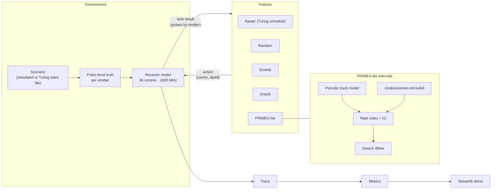

# PRIMES Prototype — Demo Scope

The smallest system that demonstrates the PRIMES idea end-to-end. The full design is in [`PRIMES_FULL_ARCHITECTURE.md`](PRIMES_FULL_ARCHITECTURE.md).

## Demo story (what the jury sees)

> **An open-loop sweep catches only ~6 % of narrow main-beam radar flashes (measured on real Turing scenarios) and can be locked out entirely. PRIMES learns each emitter's scan timing from its first few hits and misses, then catches far more flashes, finds pop-up emitters faster, and breaks lock-out, on simulated scenarios and on real Turing dataset scenarios.**

Side-by-side, same scenario, same truth:

| | Raster (open-loop) | PRIMES-lite |
|---|---|---|
| Where it looks | fixed 2.15 s sweep | predicted flashes + search |
| Lock-out scenario | never intercepts emitter | intercepts within seconds |
| Explanation | none | "centre 3250 MHz, 10 ms: track 7 flash predicted in 12 ms (P = 0.81)" |

---

## Scope

| In the prototype | Deferred to roadmap |
|---|---|
| Circular-scan periodic emitters (fixed frequency) + one hopping type + omni | Markov, aperiodic, full agility models |
| Turing receiver replica: 36 centres, ±500 MHz, exact 2.15 s raster schedule | Wideband cueing receiver, multi-receiver |
| **Ideal association:** detected pulses carry emitter IDs (upstream deinterleaver assumed) | PDW-noise association / DBSCAN / learned embeddings |
| PRIMES-lite: periodic track model, undiscovered-cell belief, rate index + IG, dwell ∈ {10, 50} ms, search dither | Whittle index, expanded hypotheses, Optuna tuning |
| Baselines: raster, random, greedy, oracle | Farey sweep, DQN comparator |
| Core metrics, 10 seeds | Full stratified statistics, 30+ seeds, ablations |
| Replay on 10 Turing `val_stare` scenarios | Full validation/test sweep, scan-mode cross-validation |
| Streamlit live demo | Residual RL, shield, deployment |

---

## Prototype architecture



---

## Components

### 1. Scenarios (`primes/env/scenario.py`)

| Family | Content | Purpose |
|---|---|---|
| `easy` | 8 circular scanners, T ∈ [1, 8] s, distinct bands | sanity; period learning |
| `lockout` | emitter with `T = 2.15 s` and phase outside *all* raster dwells covering its frequency (exact); emitter with `T = 2.20 s` (near: worst-case wait ≈ 80–90 s) | lock-out demonstration |
| `popup` | `easy` + 4 emitters appearing at random times in 5–20 s | new-emitter latency |
| `dense` | 50 emitters sampled from Turing `val_scan` metadata distributions; several per band | realism |
| `turing:<config_N>` | pulses and labels from a Turing `val_stare` file | external validation |

**Simulated emitter:**
- **Scan:** `T = 60 / rpm`, flash width `w = T · beamwidth / 360`, random phase.
- **Pulses:** fixed PRI within each flash.
- **Frequency:** fixed, or hopping across a set spanning up to 2 sub-bands.

Collection window **30 s**. ToA clipped to `[0, 30]` s for Turing files.

### 2. Receiver model (`primes/env/receiver.py`)

- **Coverage:** action `(centre_idx, dwell_ms)`; centres at `250 + 500·i` MHz, `i = 0..35`, receiving pulses with `|f − centre| ≤ 500 MHz`.
- **Detection:** a flash is **intercepted** if at least `n_min = 3` of its pulses fall inside the dwell. Optional `P_d` (default 1.0) and `P_fa` (default 0).
- **Retune cost:** `τ = 1 ms` when the centre changes.
- **Raster schedule** (exact Turing dwell times, in centre order):

```python
RASTER_DWELL_S = [0.10, 0.10, 0.05, 0.05, 0.05, 0.05, 0.10, 0.10,
                  *[0.05] * 9, 0.10, 0.10, 0.10, *[0.05] * 16]   # 36 dwells, 2.15 s cycle
```

### 3. Look interface (`primes/core/types.py`)

```python
Action = tuple[int, int]                       # (centre_idx, dwell_ms)

@dataclass
class Look:
    t_start: float
    action: Action
    pulses: dict[int, np.ndarray]              # emitter_id -> ToAs received in the dwell ({} = miss)

class Policy(Protocol):
    def reset(self, rng: np.random.Generator) -> None: ...
    def act(self, t: float) -> Action: ...
    def update(self, look: Look) -> None: ...
    def explain(self) -> dict: ...
```

### 4. Baselines (`primes/policies/baselines.py`)

| Policy | Behaviour |
|---|---|
| `Raster` | Turing schedule, repeating from t = 0 |
| `Random` | uniform centre, 50 ms dwell |
| `Greedy` | centre with the most hits so far (with small ε exploration), 50 ms dwell |
| `Oracle` | reads truth: dwells on the next flash not yet intercepted (upper bound) |

### 5. PRIMES-lite (`primes/policies/primes_lite.py`)

**Track model (per emitter ID):**
- **Flash times:** hits give flash times `f₁, f₂, …` (first received pulse, or midpoint when both edges are inside the dwell), plus observed flash width.
- **Candidate periods:** with ≥ 2 flashes, `T_k = (f₂ − f₁) / k` for all `k` with `T_k ∈ [0.5, 15] s`, phase `φ = f₁ mod T_k`.
- **Hit update:** keep candidates with `|wrap((f − φ) / T_k)| · T_k < tol` (tol = 5 ms); refit `T` by least squares over assigned flash indices.
- **Miss update:** a dwell overlapping a candidate's predicted flash, with no hit, multiplies that candidate's weight by `(1 − P_d)`, or a small floor ε when `P_d = 1`.
- **Before the second flash:** intercept probability comes from the prior, `P ≈ E_T[(d + w) / T]`.

**Undiscovered-emitter belief (per centre):**
- **Miss:** `q ← q(1 − P̄) / (1 − q·P̄)`, with `P̄ = E_prior[(d + w) / T]`.
- **Between looks:** `q ← 1 − (1 − q)·e^(−ρ·Δt)`.

**Index (per centre `c`, dwell `d ∈ {10, 50}` ms):**

```text
V  = Σ_tracks in coverage  W · staleness(e) · P_intercept(e, t, d)
   + W_new · q_c · P̄(d)
   + λ · IG,     IG = H(Σ w_h p_h) − Σ w_h H(p_h)
I  = V / (d + τ · [c ≠ c_prev])
```

**Search dither:** if the best index is within `ε` of others and no track is confident, pick among the near-ties using a golden-ratio sequence, and jitter the dwell start by up to 5 ms.

**Default parameters:** `λ = 0.3`, `ρ = 0.02 s⁻¹`, `W = W_new = 1`, staleness `g(Δ) = min(1, Δ / 2 s)`. Hand-set for the prototype; tuned in the roadmap.

**Loop:**

```text
for t in engagement:
    for (c, d) in actions: I[c, d] = index(c, d, t)
    a = dither(argmax I) if search_mode else argmax I
    look = receiver.observe(a, t)
    tracks.update(look); undiscovered.update(look); t += d + τ
```

### 6. Metrics (`primes/eval/metrics.py`)

| Metric | Definition |
|---|---|
| Interception ratio | intercepted flashes / *interceptable* flashes in window (flashes with ≥ `n_min` pulses in truth); pooled, and per emitter then mean |
| Emitters discovered | emitters with ≥ 1 intercept, over time (curve) |
| Time to first intercept | per emitter; mean and p95; undiscovered counted as 30 s and reported separately |
| New-emitter latency | pop-up appearance → first intercept |
| % correct predictions | at each hit on a track with ≥ 2 flashes, predicted next flash within ±10 ms of the actual |
| Average intercept time error | mean ‖predicted − actual next flash‖ |
| Average reward | intercepts per second of receiver time |
| P_d / P_fa | configured; small sweep of P_d ∈ {1.0, 0.9, 0.7} |

Reported as mean ± 95 % bootstrap CI over **10 seeds**.

### 7. Turing replay (`primes/data/turing_replay.py`)

- **Files:** stream 10 `val_stare/config_N.h5` files via the HF API and keep ToA, frequency and label only.
- **Flashes:** split each emitter's pulses into flashes at gaps > 50 ms.
- **Truth:** the receiver model receives stare pulses inside `(|f − centre| ≤ 500 MHz, [t, t + d])`.
- **Raster reference (measured on 11 files):** 6.3 % of narrow flashes with ≥ 3 pulses intercepted; 11.5 % of all flashes. About 80 % of sub-50 ms stare flashes have only 1–2 pulses, so they are excluded from the interceptable denominator.
- **Policies:** all run on identical truth, and results sit alongside the simulated scenarios.

### 8. Demo UI (`app/demo.py`, Streamlit + Plotly)

1. **Controls:** scenario selector, policy A vs policy B, seed, playback speed.
2. **Spectrum-time panel:** x = time, y = dwell centre. True flashes shown faint; receiver dwells as bars, hits highlighted. One row per policy.
3. **Track panel:** each PRIMES track's estimated period vs true period, converging over time.
4. **Live metrics:** interception ratio, emitters discovered, TTFI, prediction accuracy, as running curves for both policies.
5. **Decision explanation:** the latest PRIMES action with its index terms.

Runs are precomputed by replay, then animated with a time slider, so the demo is deterministic and fast.

---

## Repository layout (prototype)

```
primes/
  core/types.py
  env/scenario.py  receiver.py
  policies/baselines.py  primes_lite.py
  eval/replay.py  metrics.py
  data/turing_replay.py
app/demo.py
configs/scenarios.yaml
tests/test_receiver.py  test_tracks.py  test_index.py  test_replay.py
scripts/inspect_turing_dataset.py   # existing
```

---

## Build order

| Step | Deliverable | Check |
|---|---|---|
| 1 | `types.py`, scenario + receiver models, pulse truth | raster on `lockout` never intercepts the exact-lock-out emitter |
| 2 | replay + metrics + raster / random / oracle | deterministic replay; oracle ≥ every policy |
| 3 | track model | recovers true `T` within 1 % after ≤ 3 flashes on `easy` |
| 4 | undiscovered belief + index + dither → PRIMES-lite | beats raster and greedy on interception ratio (`easy`, `dense`) and breaks `lockout` |
| 5 | `popup` + Turing replay on 10 files | lower new-emitter latency; results on real scenarios |
| 6 | Streamlit demo | side-by-side playback of all scenarios |

## Acceptance criteria for the demo

- **Lock-out:** on `lockout`, raster never intercepts the exact-lock-out emitter in 30 s, and PRIMES does.
- **Interception ratio:** PRIMES-lite beats raster, random and greedy on `easy`, `dense` and the Turing scenarios, with non-overlapping CIs.
- **Prediction:** correct-prediction rate and intercept-time error are reported for PRIMES tracks.
- **Demo:** every number in the UI comes from replayed runs, and nothing is hard-coded.

## Run

```bash
pip install -r requirements.txt           # numpy, h5py, huggingface_hub, streamlit, plotly, pytest
pytest -q
python -m primes.eval.replay --scenario lockout --policies raster primes_lite --seeds 10
streamlit run app/demo.py
```
