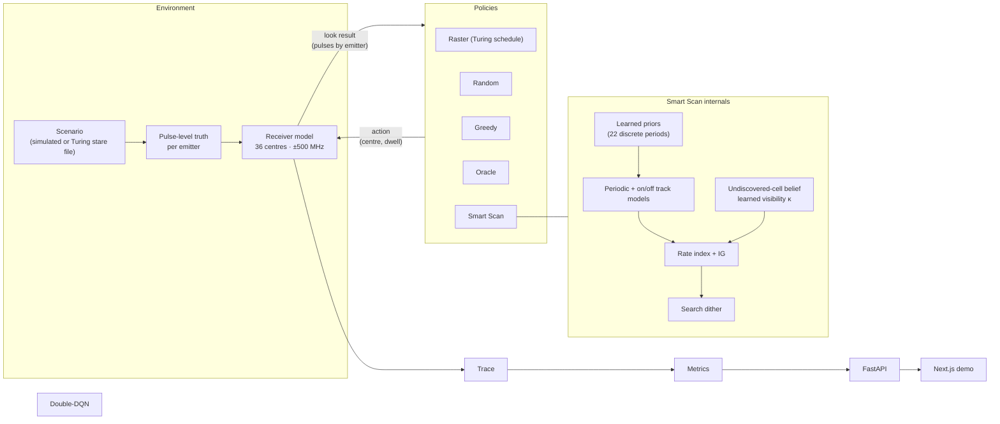

# Smart Scan Prototype — Demo Scope

The smallest system that demonstrates the Smart Scan idea end-to-end. The full design is in [`SMART_SCAN_FULL_ARCHITECTURE.md`](SMART_SCAN_FULL_ARCHITECTURE.md).

## Demo story (what the jury sees)

> **An open-loop sweep catches only ~6 % of narrow main-beam radar flashes (measured on real Turing scenarios) and can be locked out entirely. Smart Scan learns each emitter's scan timing from its first few hits and misses, then catches far more flashes, finds pop-up emitters faster, and breaks lock-out, on simulated scenarios and on real Turing dataset scenarios.**

Side-by-side, same scenario, same truth:

| | Raster (open-loop) | Smart Scan |
|---|---|---|
| Where it looks | fixed 2.15 s sweep | predicted flashes + search |
| Lock-out scenario | never intercepts emitter | intercepts within seconds |
| Explanation | none | "centre 3250 MHz, 10 ms: track 7 flash predicted in 12 ms (P = 0.81)" |

---

## Scope

| In the prototype | Deferred to roadmap |
|---|---|
| Circular-scan periodic emitters (fixed, multi-frequency, hopping), omni, **intermittent on/off (Markov)** and pop-up emitters | Aperiodic / Poisson, full agility models |
| Turing receiver replica: 36 centres, ±500 MHz, exact 2.15 s raster schedule | Wideband cueing receiver, multi-receiver |
| **Ideal association:** detected pulses carry emitter IDs (upstream deinterleaver assumed) | PDW-noise association / DBSCAN / learned embeddings |
| **Learned priors** from 2,500 Turing training scenarios (HF API) | Empirical-Bayes refits from field logs |
| Smart Scan: periodic **and Gilbert–Elliott** track models, undiscovered-cell belief with **online-learned visibility κ**, rate index + IG, dwell ∈ {10, 25, 50, 100} ms, search dither, per-decision explanation | Whittle index, aperiodic hypotheses, Optuna tuning |
| Baselines: raster, random, greedy bandit, oracle; **Double-DQN comparator** (SB3) | Farey sweep, residual RL + shield |
| Core metrics, 10 seeds, bootstrap CIs; ablations (flat prior, no information gain) | Stratified statistics, 30+ seeds, per-track association ablation |
| Replay on 11 Turing `val_stare` scenarios | Full validation/test sweep, scan-mode cross-validation |
| FastAPI backend + **Next.js** demo (mission replay, benchmark) | Deployment, edge port |

---

## Prototype architecture



---

## Components

### 1. Scenarios (`primes/env/scenario.py`)

| Family | Content | Purpose |
|---|---|---|
| `easy` | 8 circular scanners, T ∈ [1, 8] s, distinct bands | sanity; period learning |
| `lockout` | emitter with `T = 2.15 s` and phase outside *all* raster dwells covering its frequency (exact); emitter with `T = 2.20 s` (near: worst-case wait ≈ 80–90 s) | lock-out demonstration |
| `popup` | `easy` + 4 emitters appearing at random times in 5–20 s | new-emitter latency |
| `dense` | 50 emitters sampled from Turing `val_scan` metadata distributions; several per band | realism |
| `turing:<config_N>` | pulses and labels from a Turing `val_stare` file | external validation |

**Simulated emitter:**
- **Scan:** `T = 60 / rpm`, flash width `w = T · beamwidth / 360`, random phase.
- **Pulses:** fixed PRI within each flash.
- **Frequency:** fixed, or hopping across a set spanning up to 2 sub-bands.

Collection window **30 s**. ToA clipped to `[0, 30]` s for Turing files.

### 2. Receiver model (`primes/env/receiver.py`)

- **Coverage:** action `(centre_idx, dwell_ms)`; centres at `250 + 500·i` MHz, `i = 0..35`, receiving pulses with `|f − centre| ≤ 500 MHz`.
- **Detection:** a flash is **intercepted** if at least `n_min = 3` of its pulses fall inside the dwell. Optional `P_d` (default 1.0) and `P_fa` (default 0).
- **Retune cost:** `τ = 1 ms` when the centre changes.
- **Raster schedule** (exact Turing dwell times, in centre order):

```python
RASTER_DWELL_S = [0.10, 0.10, 0.05, 0.05, 0.05, 0.05, 0.10, 0.10,
                  *[0.05] * 9, 0.10, 0.10, 0.10, *[0.05] * 16]   # 36 dwells, 2.15 s cycle
```

### 3. Look interface (`primes/core/types.py`)

```python
Action = tuple[int, int]                       # (centre_idx, dwell_ms)

@dataclass
class Look:
    t_start: float
    action: Action
    pulses: dict[int, np.ndarray]              # emitter_id -> ToAs received in the dwell ({} = miss)

class Policy(Protocol):
    def reset(self, rng: np.random.Generator) -> None: ...
    def act(self, t: float) -> Action: ...
    def update(self, look: Look) -> None: ...
    def explain(self) -> dict: ...
```

### 4. Baselines (`primes/policies/baselines.py`)

| Policy | Behaviour |
|---|---|
| `Raster` | Turing schedule, repeating from t = 0 |
| `Random` | uniform centre, 50 ms dwell |
| `Greedy` | centre with the most hits so far (with small ε exploration), 50 ms dwell |
| `Oracle` | reads truth: dwells on the next flash not yet intercepted (upper bound) |

### 5. Smart Scan (`primes/policies/primes_lite.py`)

**Track model (per emitter ID):**
- **Flash times:** hits give flash times `f₁, f₂, …` (first received pulse, or midpoint when both edges are inside the dwell), plus observed flash width.
- **Candidate periods:** with ≥ 2 flashes, `T_k = (f₂ − f₁) / k` for all `k` with `T_k ∈ [0.5, 15] s`, phase `φ = f₁ mod T_k`.
- **Hit update:** keep candidates with `|wrap((f − φ) / T_k)| · T_k < tol` (tol = 5 ms); refit `T` by least squares over assigned flash indices.
- **Miss update:** a dwell overlapping a candidate's predicted flash, with no hit, multiplies that candidate's weight by `(1 − P_d)`, or a small floor ε when `P_d = 1`.
- **Before the second flash:** intercept probability comes from the prior, `P ≈ E_T[(d + w) / T]`.

**Undiscovered-emitter belief (per centre):**
- **Miss:** `q ← q(1 − P̄) / (1 − q·P̄)`, with `P̄ = E_prior[(d + w) / T]`.
- **Between looks:** `q ← 1 − (1 − q)·e^(−ρ·Δt)`.

**Index (per centre `c`, dwell `d ∈ {10, 50}` ms):**

```text
V  = Σ_tracks in coverage  W · staleness(e) · P_intercept(e, t, d)
   + W_new · q_c · P̄(d)
   + λ · IG,     IG = H(Σ w_h p_h) − Σ w_h H(p_h)
I  = V / (d + τ · [c ≠ c_prev])
```

**Search dither:** if the best index is within `ε` of others and no track is confident, pick among the near-ties using a golden-ratio sequence, and jitter the dwell start by up to 5 ms.

**Default parameters:** `λ = 0.3`, `ρ = 0.02 s⁻¹`, `W = W_new = 1`, staleness `g(Δ) = min(1, Δ / 2 s)`. Hand-set for the prototype; tuned in the roadmap.

**Loop:**

```text
for t in engagement:
    for (c, d) in actions: I[c, d] = index(c, d, t)
    a = dither(argmax I) if search_mode else argmax I
    look = receiver.observe(a, t)
    tracks.update(look); undiscovered.update(look); t += d + τ
```

**Optional variants** (off by default, measured): `use_threat` scales each track's value by its expected threat weight from `primes/threat/model.py`; `use_existence` discounts each track by its probability of being real (log-odds raised by repeat hits, lowered by reliable misses).

### 6. Metrics (`primes/eval/metrics.py`)

| Metric | Definition |
|---|---|
| Interception ratio | intercepted flashes / *interceptable* flashes in window (flashes with ≥ `n_min` pulses in truth); pooled, and per emitter then mean |
| Emitters discovered | emitters with ≥ 1 intercept, over time (curve) |
| Time to first intercept | per emitter; mean and p95; undiscovered counted as 30 s and reported separately |
| New-emitter latency | pop-up appearance → first intercept |
| % correct predictions | at each hit on a track with ≥ 2 flashes, predicted next flash within ±10 ms of the actual |
| Average intercept time error | mean ‖predicted − actual next flash‖ |
| Average reward | intercepts per second of receiver time |
| P_d / P_fa | swept: P_d ∈ {1, 0.9, 0.7, 0.5}, P_fa ∈ {0, 0.001, 0.005, 0.02} per look (`experiments/robustness.py`) |
| False alarms | false detections per run; each gets a unique id and a plausible pulse train, so it looks like a new emitter |
| False-alarm rejection time / real tracks dropped | time until a false track's existence odds fall below threshold; real tracks wrongly marked dead |
| Threat-weighted / high-threat interception, high-threat TTFI | interception weighted 0.3 / 1 / 3 by threat level; high-threat subset only |
| Threat class accuracy | share of tracks whose online predicted threat level matches the label |

Reported as mean ± 95 % bootstrap CI over **10 seeds**.

**Robustness result** (1,008 runs, all 36 scenarios pooled):

| Condition | Raster | Greedy | **Smart Scan** (95 % CI) | Oracle | Smart Scan / oracle | Smart Scan on real scenarios |
|---|---|---|---|---|---|---|
| nominal (P_d = 1, P_fa = 0) | 10.3 % | 16.1 % | **69.0 %** [65.5, 72.1] | 91.6 % | 0.75 | 69.8 % |
| P_d = 0.9 | 9.6 % | 15.9 % | **62.7 %** [58.9, 66.1] | 87.4 % | 0.72 | 62.1 % |
| P_d = 0.7 | 8.2 % | 13.9 % | **55.5 %** [51.7, 59.2] | 77.4 % | 0.72 | 56.9 % |
| P_d = 0.5 | 6.3 % | 12.4 % | **44.4 %** [40.3, 48.8] | 66.5 % | 0.67 | 48.2 % |
| P_fa = 0.001 per look (~5 false alarms / run) | 10.3 % | 15.6 % | **68.1 %** [65.0, 71.0] | 91.6 % | 0.74 | 69.7 % |
| P_fa = 0.005 (~23 / run) | 10.3 % | 16.6 % | **66.8 %** [62.7, 70.8] | 91.6 % | 0.73 | 70.3 % |
| P_fa = 0.02 (~70 / run, stress) | 10.3 % | 16.4 % | **58.4 %** [54.0, 62.9] | 91.6 % | 0.64 | 66.8 % |

### 7. Turing replay (`primes/data/turing.py`)

- **Files:** 11 `val_stare/config_N.h5` files, fetched from the HF hub on first use into `data/raw/` (git-ignored).
- **Flashes:** split each emitter's pulses into flashes at gaps > 50 ms.
- **Truth:** the receiver model receives stare pulses inside `(|f − centre| ≤ 500 MHz, [t, t + d])`.
- **Raster reference (measured on 11 files):** 6.3 % of narrow flashes with ≥ 3 pulses intercepted; 11.5 % of all flashes. About 80 % of sub-50 ms stare flashes have only 1–2 pulses, so they are excluded from the interceptable denominator.
- **Policies:** all run on identical truth, and results sit alongside the simulated scenarios.

### 8. Backend and demo (`api/main.py`, `web/`)

**FastAPI:** `GET /api/catalog` (scenarios, policies), `POST /api/runs` (replay the requested policies on identical truth, cache to disk), `GET /api/runs/{id}`, `GET /api/benchmark`.

**Next.js — Mission page (`/mission`):**
1. **Controls:** scenario picker (six cards); one "Run all receivers" action. Lineup: Smart Scan, Double-DQN, Greedy bandit, Raster, Random, plus Oracle as a dashed upper-bound reference.
2. **Live leaderboard:** flashes caught and radars found, re-ranked at the playback cursor.
3. **Spectrum-time small multiples:** one canvas per receiver, synced to the same cursor (x = time, y = frequency; truth ticks, dwells, intercepts).
4. **Cumulative chart and results:** flashes caught over time for every line (Oracle dashed); winner badges, metric bars, ranked scorecard.
5. **Smart Scan decision strip:** mode, frequency, dwell, and score breakdown at the cursor (links to "How it decides").
6. **Learned tracks:** estimated vs true period (or intermittent) per emitter in the Smart Scan lane.

**Benchmark page:** per-scenario interval plots (mean, 95 % bootstrap CI) for every scheduler and metric, plus a table.

Runs are precomputed by replay, then animated with a time slider, so the demo is deterministic and fast.

---

## Repository layout (prototype)

```
primes/
  core/types.py                     receiver constants, Look / Truth types, flash splitting
  env/scenarios.py  receiver.py     scenario families, receiver model
  data/fit_priors.py  priors.py  turing.py
  assets/priors.json                learned priors (committed)
  predict/track.py  markov.py  search.py
  policies/baselines.py  primes_lite.py  dqn.py
  rl/env.py  features.py  double_dqn.py  train_dqn.py
  eval/replay.py  metrics.py  serialize.py  runner.py
api/main.py
experiments/benchmark.py
web/                                Next.js app
tests/test_core.py  test_primes.py
scripts/inspect_turing_dataset.py
```

---

## Build order

| Step | Deliverable | Check |
|---|---|---|
| 1 | `types.py`, scenario + receiver models, pulse truth | raster on `lockout` never intercepts the exact-lock-out emitter |
| 2 | replay + metrics + raster / random / oracle | deterministic replay; oracle ≥ every policy |
| 3 | track model | recovers true `T` within 1 % after ≤ 3 flashes on `easy` |
| 4 | undiscovered belief + index + dither → Smart Scan | beats raster and greedy on interception ratio (`easy`, `dense`) and breaks `lockout` |
| 5 | `popup` + Turing replay on 10 files | lower new-emitter latency; results on real scenarios |
| 6 | FastAPI + Next.js demo | side-by-side playback of all scenarios |
| 7 | Double-DQN comparator + multi-seed benchmark | fair ML rival; confidence intervals |

## Acceptance criteria for the demo

- **Lock-out:** on `lockout`, raster never intercepts the exact-lock-out emitter in 30 s, and Smart Scan does.
- **Interception ratio:** Smart Scan beats raster, random and greedy on `easy`, `dense` and the Turing scenarios, with non-overlapping CIs.
- **Prediction:** correct-prediction rate and intercept-time error are reported for Smart Scan tracks.
- **Demo:** every number in the UI comes from replayed runs, and nothing is hard-coded.

## Run

```bash
pip install -r requirements.txt
pytest -q
python -m experiments.benchmark --seeds 10 --workers 6     # artifacts/benchmark.json
uvicorn api.main:app --port 8000
cd web && npm install && npm run dev                        # http://localhost:3000
```
